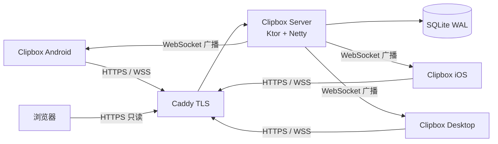

# Clipbox

离线优先的跨设备文本中转与本地工具箱。Android、iPhone / iPad 与电脑之间传文本，不必发消息给自己，也不必登录网页。

> **当前状态**：v1.0.0 设计冻结。四份设计与需求文档已完成；`ClipboxClient/` 与 `ClipboxServer/` 代码工程待按文档实现。

## 特性

| 能力 | 说明 |
| --- | --- |
| 设备配对 | 服务端签发 6 位一次性配对码（10 分钟有效），配对后设备持有独立令牌 |
| 文本发送 | Android 通过系统分享、文本选中菜单、App 输入框发送；iOS 通过系统分享扩展与 App 输入框发送；Desktop 通过窗口输入框或剪贴板监听发送 |
| 实时接收 | WebSocket 广播，前台即时可见，一键复制；Desktop 可自动写入系统剪贴板；iOS 回到前台先 REST 补拉 |
| 历史记录 | 本地搜索、置顶、删除；展示最近 200 条非置顶记录与全部置顶记录 |
| 离线优先 | 所有写操作先落本地并进入待发队列（Outbox），联网后按序重放；服务端不可用不阻断本地功能 |
| 分享链接 | 由剪贴记录生成只读网页，有效期 1 小时 / 24 小时 / 7 天，可选阅后即焚 |
| 工具箱 | JSON、Base64、URL、时间戳、正则 5 个纯本地工具，断网可用、不上传内容 |
| 诊断日志 | 设置页开关；debug 默认开、release 默认关，开启后网络日志含请求 / 响应体与令牌，仅本机输出 |

不承担：图片 / 文件 / 音视频传输、多用户与账号体系、云端 AI、端到端加密（P2 评估）。

v1.0.0 不含：iOS / Android 后台推送与通知、移动端后台剪贴板、片段收藏夹、托盘 / 全局快捷键。

## 架构



- 客户端：Compose Multiplatform（Android + iOS + Desktop 共享 UI 与业务代码）+ Room KMP + Ktor Client，本地库是唯一数据源。
- 服务端：Ktor + Exposed + SQLite WAL，单实例部署，目标资源 2 核 / 2GB / 3Mbps，JVM `-Xmx256m`。
- 同步：服务端为每次创建、置顶、删除分配单调递增的 `serverSeq`；客户端用 `since` 增量拉取，断线后自动补齐，落后于墓碑清理线时全量重同步。

## 仓库结构

```text
ClipBox/
├── ClipboxClient/        # 客户端 Gradle 根工程（待实现）
│   ├── composeApp/       # Compose Multiplatform 共享 UI；src/{commonMain,androidMain,iosMain,desktopMain}
│   └── iosApp/           # iOS SwiftUI 壳、Share Extension、Xcode 工程
├── ClipboxServer/        # 服务端 Gradle 工程（待实现）
└── docs/
    ├── 功能需求文档.md
    ├── api.md
    ├── 客户端技术架构.md
    ├── 服务端技术架构.md
    ├── Clipbox 项目交接文档.md
    ├── GLOSSARY.md       # 领域术语表
    ├── README.md
    └── adr/              # 架构决策记录
```

## 文档

| 文档 | 内容 | 权威范围 |
| --- | --- | --- |
| [功能需求文档](功能需求文档.md) | 108 条 REQ，Given / When / Then 验收条件与追溯矩阵 | 产品行为与验收标准 |
| [API 契约](api.md) | 路径、字段、错误码、限流、同步语义、示例 | 客户端与服务端之间唯一接口依据 |
| [客户端技术架构](客户端技术架构.md) | 分层、Room Schema、SyncEngine、Outbox、三端平台能力、iOS 分享扩展、诊断日志 | 客户端实现细节 |
| [服务端技术架构](服务端技术架构.md) | 模块划分、SQLite Schema、清理任务、Docker 部署 | 服务端实现细节 |
| [术语表](GLOSSARY.md) | 剪贴记录、同步游标、墓碑等规范用词 | 全项目术语 |
| [ADR-0001](adr/0001-server-seq-change-feed.md) | 用 `serverSeq` 变更流替代 ULID 游标 | 同步机制决策 |
| [ADR-0002](adr/0002-share-content-snapshot.md) | 分享保存内容快照而非记录引用 | 分享生命周期决策 |

## 核心设计

- **变更序号是同步唯一权威**：`createdAt` 只用于界面排序，客户端不得用它推断同步进度。`lastSeq` 只由 REST 补拉或连续的 WebSocket 事件推进，写接口的响应不推进游标。
- **保留与墓碑**：服务端保留全部置顶 + 最新 500 条非置顶记录，超出部分先软删除；墓碑保留 30 天后物理清理并推进 `sync_floor`。客户端本地裁剪不向服务端传播删除。
- **分享快照**：分享页保存创建时的正文快照，与剪贴记录后续删除、清理解耦；一次性分享在首次 GET 时原子消费，过期或已消费返回 410。
- **离线写入**：写操作在同一个 Room 事务中落本地并插入 Outbox；重试区分可重试、永久失败、401 与 429，永久失败可由用户手动重试。
- **剪贴板回环防护**：桌面端用 `lastAppliedHash` / `lastSentHash` 与时间窗口避免自动写入与自动上传互相触发。
- **限流与上限**：单条正文 64 KiB（请求体上限 512 KiB），配对接口 5 次/分钟/IP，分享页 60 次/分钟/IP。

## 快速开始

以下命令在代码工程落地后适用，当前仓库仅包含设计文档。

### 服务端

前置：JDK 21、Docker。

```bash
# 1. 按《服务端技术架构》§11 创建 Dockerfile、docker-compose.yml 与 Caddyfile
# 2. 准备 .env
cat > .env <<'EOF'
ADMIN_TOKEN=<至少 32 字符的随机串>
PUBLIC_BASE_URL=https://clip.example.com
EOF

# 3. 启动
docker compose up -d --build

# 4. 健康检查
curl -sS https://clip.example.com/healthz
```

### 客户端

前置：JDK 21、Android Studio（Android 目标）；iOS 目标另需 macOS + Xcode。桌面端支持 Windows 10+、macOS 12+、主流 Linux 桌面；Android 最低 8.0（API 26），iOS 最低 16.0。

```bash
cd ClipboxClient

# Android
./gradlew :composeApp:assembleDebug

# Desktop
./gradlew :composeApp:run

# iOS：先用 Gradle 生成共享框架，再用 Xcode 打开 iosApp 工程
./gradlew :composeApp:linkDebugFrameworkIosSimulatorArm64
open iosApp/iosApp.xcodeproj
```

### 配对

```bash
# 管理端生成一次性配对码
curl -sS -X POST https://clip.example.com/api/v1/admin/pairing-codes \
  -H "X-Admin-Token: $ADMIN_TOKEN"
```

在客户端输入返回的 6 位配对码完成配对；令牌只返回一次，服务端仅保存其 SHA-256 哈希。

## 安全与隐私

- 正式环境仅允许 HTTPS / WSS，由 Caddy 终止 TLS。
- 设备令牌与分享令牌均为 32 字节随机数，服务端只存哈希。
- 客户端 release 默认零应用日志；debug 诊断日志开启后可包含请求 / 响应体与令牌，仅输出到本机系统日志，不上传、不落盘；正常与崩溃日志不含正文与令牌。
- 不集成第三方日志、崩溃或行为分析 SDK。
- 配对码一次性、10 分钟有效、按 IP 限流；管理接口需 `X-Admin-Token`，建议叠加来源 IP 限制。
- 分享页转义正文并设置 CSP，令牌不出现在代理访问日志。
- 客户端数据以明文存储于应用沙箱，v1.0.0 不含端到端加密，已在「关于」页披露。
- 工具箱完全离线，不写历史、不上传内容、不记录输入输出日志。

## 路线图

v1.0.0 交付 P0 核心同步能力与 P1 的分享链接、5 个工具箱。以下项目延后：

- 片段收藏夹（Snippet）与 LWW 冲突解决
- iOS / Android 后台推送与通知
- 移动端后台剪贴板
- 托盘、全局快捷键、透明复制页
- 端到端加密

## 术语

「剪贴记录」「同步游标」「墓碑」「强制重同步」等术语的准确定义见 [GLOSSARY.md](GLOSSARY.md)。
