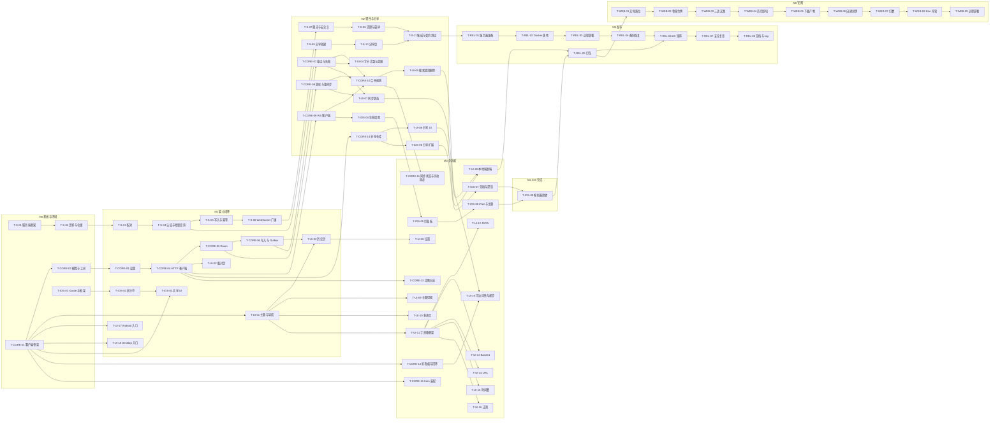

# Clipbox v1.0.0 任务拆解

本文档把 `docs/` 中已冻结的需求与架构转换为**可逐张派发的任务卡**。每张卡是一个 0.5–1 天的独立工作单元，有单一可验证产出；按 `docs/tasks/` 中的工作流文件顺序执行即可交付 v1.0.0。

> 代码工程当前为空：`ClipboxClient/` 与 `ClipboxServer/` 仅有 `.gitkeep`。第一张卡从零初始化。

## 1. 执行基线

| 项 | 决定 |
| --- | --- |
| 执行方式 | 单 Agent 串行，主分支开发，一卡一提交；里程碑打 tag |
| 部署 | 学习版 HTTP + IP 直连，仅 server 容器发布 `8080`，无 Caddy / TLS（[ADR-0003](../adr/0003-http-ip-learning-deployment.md)） |
| 包名 | 客户端 `com.wangxingxing.clipbox`；服务端 `com.wangxingxing.clipbox.server` |
| 本地联调 | 服务端本机 `:8080`；Android 模拟器 / 真机用 `adb reverse tcp:8080 tcp:8080` 后访问 `http://localhost:8080` |
| 交付物 | Android debug APK、macOS Desktop 包、iOS 模拟器构建；不含 Windows / Linux 包与 iOS 真机签名 |
| 测试 | 每卡自带验收命令；服务端 Ktor `testApplication` 集成测试；客户端同步内核单元测试；UI 用 AVD `Medium_Phone_API_37` + Desktop 截图人工核对；不做全量 UI 自动化、不搭 CI |
| iOS | 从 M1 起交错参与（不是真正并行）；Xcode 安装是 M0 的用户动作卡 |
| 范围排除 | 后台推送 / 通知、移动端后台剪贴板、片段收藏夹、托盘 / 全局快捷键、端到端加密、HTTPS |

## 2. 里程碑

| 里程碑 | 主题 | 出口条件（Gate） |
| --- | --- | --- |
| M0 | 基线与环境 | 两个工程可构建；服务端 `/healthz` 返回 200；客户端三端空壳可启动；iOS 工具链可用 |
| M1 | 最小同步闭环 | 手机分享 / 输入文本 → 服务端 → Desktop 实时收到；Desktop 发送 → Android 前台可见并可复制；配对可用 |
| M2 | 同步韧性与分享 | 断网排队重放、游标补拉、WS 缺口补拉、全量重同步可用；分享链接可生成、可访问、一次性语义正确 |
| M3 | 全功能 | 搜索 / 置顶 / 删除、5 个工具箱、设置、主题、多语言、诊断日志、Desktop 剪贴板完整；Android 与 Desktop 可日常自用 |
| M4 | iOS 完成 | iOS 宿主、共享 UI、前后台同步、分享扩展、iPad 布局全部可用；模拟器构建通过 |
| M5 | 发布与验收 | 远程服务器部署；APK / macOS 包产出；AC-01…AC-20 全部有证据；v1.0.0 打 tag |
| M6 | 官网 | 三语单页官网上线；五端下载矩阵与 Range 可用；同容器托管；远程验收通过 |

## 3. 工作流与文件索引

| 文件 | 范围 | 卡片 |
| --- | --- | --- |
| [01-server.md](01-server.md) | Ktor 服务端：配对、同步、WS、分享、清理、测试 | T-S-01…T-S-11 |
| [02-client-core.md](02-client-core.md) | KMP 共享层：模型、Room、Outbox、SyncEngine、WS、剪贴板、日志 | T-CORE-01…T-CORE-15 |
| [03-client-ui.md](03-client-ui.md) | Compose UI 与平台入口：主题、历史、配对、设置、分享、工具箱、Android / Desktop | T-UI-01…T-UI-20 |
| [04-ios.md](04-ios.md) | iOS 宿主、生命周期、分享扩展、iPad、模拟器验收 | T-IOS-01…T-IOS-09 |
| [05-release.md](05-release.md) | 远程部署、打包、验收矩阵、安全复查、发版 | T-REL-01…T-REL-08 |
| [06-web.md](06-web.md) | 官网：三语单页、下载矩阵、自建说明、Ktor 托管与远程部署 | T-WEB-01…T-WEB-09 |
| [PROMPTS.md](PROMPTS.md) | 派单与返修提示词模板、停止条件、提交规范 | — |

## 4. 依赖关系

图只画主要依赖；卡内「前置」字段是派单的唯一依据。同层无依赖的卡可以按第 5 节顺序依次执行。

## 5. 推荐派单顺序

严格按下列顺序逐张派发。括号内是里程碑；每张卡完成并提交后再发下一张。

1. T-S-01（M0）
2. T-CORE-01（M0）
3. T-S-02（M0）
4. T-CORE-02（M0）
5. T-IOS-01（M0，用户安装 Xcode；可与其他卡交错）
6. T-S-03（M1）
7. T-CORE-03（M1）
8. T-S-04（M1）
9. T-CORE-04（M1）
10. T-S-05（M1）
11. T-CORE-05（M1）
12. T-S-06（M1）
13. T-CORE-06（M1）
14. T-UI-01（M1）
15. T-UI-02（M1）
16. T-UI-03（M1）
17. T-UI-17（M1）
18. T-UI-18（M1）
19. T-IOS-02（M1）
20. T-IOS-03（M1）→ **M1 Gate：跑通手机 → Desktop 文本闭环**
21. T-S-07（M2）
22. T-S-08（M2）
23. T-CORE-07（M2）
24. T-CORE-08（M2）
25. T-S-09（M2）
26. T-S-10（M2）
27. T-CORE-14（M2）
28. T-CORE-09（M2）
29. T-CORE-10（M2）
30. T-UI-04（M2）
31. T-UI-05（M2）
32. T-UI-06（M2）
33. T-UI-07（M2）
34. T-S-11（M2）
35. T-IOS-04（M2）
36. T-IOS-05（M2）
37. T-IOS-06（M2）
38. T-IOS-07（M2）→ **M2 Gate：断网重放、补拉与分享全部验证**
39. T-CORE-11（M3）
40. T-CORE-12（M3）
41. T-CORE-13（M3）
42. T-CORE-15（M3）
43. T-UI-08（M3）
44. T-UI-09（M3）
45. T-UI-10（M3）
46. T-UI-11（M3）
47. T-UI-12（M3）
48. T-UI-13（M3）
49. T-UI-14（M3）
50. T-UI-15（M3）
51. T-UI-16（M3）
52. T-UI-19（M3）
53. T-UI-20（M3）→ **M3 Gate：Android + Desktop 日常可用**
54. T-IOS-08（M3→M4）
55. T-IOS-09（M4）→ **M4 Gate：iOS 模拟器验收**
56. T-REL-01（M5，用户准备服务器）
57. T-REL-02（M5）
58. T-REL-03（M5）
59. T-REL-04（M5）
60. T-REL-05（M5）
61. T-REL-06（M5）
62. T-REL-07（M5）
63. T-REL-08（M5）→ **v1.0.0 发布**
64. T-WEB-01（M6）
65. T-WEB-02（M6）
66. T-WEB-03（M6）
67. T-WEB-04（M6）
68. T-WEB-05（M6）
69. T-WEB-06（M6）
70. T-WEB-07（M6）
71. T-WEB-08（M6）
72. T-WEB-09（M6）→ **M6 Gate：官网与下载远程可用**

> 若某卡验收失败，不要跳到下一卡；按 `PROMPTS.md` 的「验收失败修复」模板重新派同一张卡，最多两轮，仍失败则停下汇报。

## 6. 卡的状态跟踪

在每次派单后更新下表；状态只用 `待开始 / 进行中 / 已完成 / 阻塞`。

| 工作流 | 卡片 | 状态 | 提交 |
| --- | --- | --- | --- |
| Server | T-S-01…T-S-11 | 已完成 | `e57aed5`（T-S-11）；M2 Gate 见 [m2-gate.md](m2-gate.md) |
| Client Core | T-CORE-01…T-CORE-15 | 已完成 | 最后一张 `fe04070`（T-CORE-15）；M3 见 [m3-gate.md](m3-gate.md) |
| Client UI | T-UI-01…T-UI-20 | 已完成 | 最后一张 T-UI-20（M3 Gate 提交）；M3 见 [m3-gate.md](m3-gate.md) |
| iOS | T-IOS-01…T-IOS-09 | 已完成 | 最后一张 T-IOS-09（M4 Gate 提交）；M4 见 [m4-gate.md](m4-gate.md) |
| Release | T-REL-01…T-REL-08 | 待开始 | — |
| Web | T-WEB-01…T-WEB-09 | 待开始 | — |

> M2 已于 2026-11-17 通过（证据见 [m2-gate.md](m2-gate.md)）；M3 于同日有条件通过，AC-11 全量分页冲突（D8）已于 2026-11-18 由 [BUG-001](bug-001-ac11-full-sync-floor.md) 修复关闭（证据见 [m3-gate.md](m3-gate.md)）；M4 于同日通过（证据见 [m4-gate.md](m4-gate.md)）；下一张为 T-REL-01。

## 7. 统一 DoD

一张卡只有同时满足以下条件才算完成：

- [ ] 任务卡「验收」中的命令全部执行，输出证据粘贴在提交说明或交接记录中。
- [ ] 新增 / 修改代码可编译，且未破坏上一张卡的验收命令。
- [ ] 没有留下 `TODO`、占位实现、注释掉的死代码或调试输出。
- [ ] 只改本卡「涉及路径」内的文件；跨卡改动需在提交说明中说明原因。
- [ ] 一卡一个提交，提交信息为 `T-XX: <一句话>`。
- [ ] 若实际实现偏离文档，已在提交说明标注，并提示需要回写哪份文档；不得静默偏离。

## 8. 需求与验收覆盖

| 域 | REQ 范围 | 主要落点 |
| --- | --- | --- |
| 配对 | PAIR-001…008 | T-S-03、T-CORE-03、T-UI-02、T-UI-08 |
| 发送 | SEND-001…010 | T-S-05、T-CORE-06、T-UI-03/04、T-UI-17/18 |
| 接收 | RECV-001…008 | T-S-06、T-CORE-09、T-UI-07、T-IOS-04 |
| 历史 | HIST-001…011 | T-S-05、T-CORE-05、T-UI-03/05 |
| 同步 | SYNC-001…015 | T-S-04/06/08、T-CORE-06/07/08/09/10/11 |
| 分享 | SHARE-001…010 | T-S-09/10、T-CORE-14、T-UI-06 |
| 工具箱 | TOOL-001…009 | T-UI-11…16 |
| 设置 | SET-001…011 | T-UI-08/09/10、T-CORE-03/12/13 |
| 平台 | PLAT-001…009 | 全部 UI / iOS / Release 卡 |
| 官网 | WEB-001…0NN | T-WEB-02…09 |
| 非功能 | NFR-001…017 | T-S-07/11、T-REL-07、各卡验收 |

最终 AC-01…AC-20 的逐条证据在 T-REL-06 汇总。

## 9. 与其他文档的关系

- 产品行为与验收：`docs/功能需求文档.md`
- 接口唯一契约：`docs/api.md`
- 客户端实现细节：`docs/客户端技术架构.md`
- 服务端实现细节：`docs/服务端技术架构.md`
- 官网需求与验收：`docs/web-功能需求.md`
- 官网实现细节：`docs/web-架构.md`
- 官网托管决策：`docs/adr/0004-web-static-hosting.md`
- 领域术语：`docs/GLOSSARY.md`
- 视觉与交互基准：`design/Clipbox 三端设计.html`、`design/README.md`、`design/brand-spec.md`
- 执行协议与不变量：仓库根目录 `AGENTS.md`

冲突时优先级：`api.md`（接口）> `功能需求文档.md`（行为）> 架构文档（实现）> 任务卡（执行提示）。发现冲突先停下报告，不要自行选择。
