# Clipbox 客户端技术架构 v1.0.0

| 字段 | 内容 |
| --- | --- |
| 文档版本 | v1.0.0 |
| 更新日期 | 2026-11-13 |
| 状态 | 设计冻结，作为客户端实现依据 |
| 基线 | [Clipbox 项目交接文档](./Clipbox%20项目交接文档.md) v0.1 |
| 接口契约 | [api.md](./api.md) |
| 术语 | [GLOSSARY.md](GLOSSARY.md) |
| 适用产品 | Clipbox v1.0.0，Android 8.0+ 与 Desktop（Windows / macOS / Linux） |

## 1. 目标与范围

客户端是离线优先的跨设备文本中转工具：

- 本地 Room 数据库是唯一数据源，UI 只观察本地数据。
- 所有写操作先落本地并进入待发队列（Outbox），再由 SyncEngine 异步同步。
- Android 通过系统分享、文本选中菜单与 App 内输入框发送；前台时同步并展示最新文本，一键复制。
- Desktop 通过窗口输入框发送；可监听系统剪贴板自动发送（默认关闭）；收到远端文本时自动写入剪贴板（默认开启）。
- v1.0.0 额外包含一次性分享链接与 5 个纯本地工具箱。
- iOS、Android 后台推送、片段收藏夹、托盘/全局快捷键、端到端加密不在 v1.0.0 范围。

## 2. 约束

| 约束 | 影响 |
| --- | --- |
| Android 10+ 前后台剪贴板限制 | 不做后台自动读写；接收依赖前台同步与用户一键复制 |
| 服务端 2 核 / 2GB / 3Mbps | 只传文本；单条 64 KiB；不做图片、文件、音视频 |
| 单用户多设备 | 不做账号体系；配对即设备身份 |
| 服务器是同步中枢 | 客户端必须能长时间离线工作；服务端不可用时功能不中断 |
| Compose Multiplatform | Android 与 Desktop 共享 UI、ViewModel、仓储与同步引擎 |
| 版本兼容 | 以 JetBrains KMP 模板锁定版本，不追新；升级单独验证 |

## 3. 上下文与容器视图

### 3.1 C4 L1：系统上下文

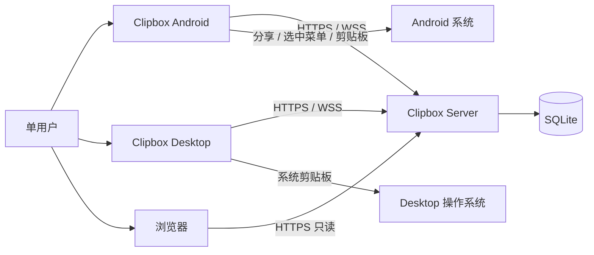

- 客户端只与 Clipbox Server 通信，不调用第三方服务。
- 分享页由浏览器直接访问服务端，不经过客户端。
- Android 与 Desktop 是两个独立进程，但共享同一套 `shared` 代码。

### 3.2 C4 L2：客户端容器

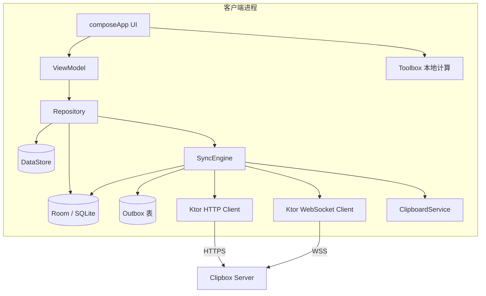

| 容器 | 职责 |
| --- | --- |
| `composeApp` | 页面、导航、主题、平台入口、平台剪贴板实现 |
| `shared` | 模型、网络、Room、同步引擎、仓储、设置、工具函数 |
| Room | 剪贴记录、Outbox、同步游标的唯一持久化数据源 |
| DataStore | 服务器地址、设备令牌、设备信息、开关与主题 |
| SyncEngine | Outbox 重放、增量拉取、全量重同步、WS 事件应用 |
| ClipboardService | 平台剪贴板读写与 Desktop 监听 |
| Toolbox | 纯本地文本处理，不依赖网络与数据库 |

## 4. 工程结构

当前工作区按客户端与服务端分目录：

```text
ClipBox/
├── ClipboxClient/                         # 客户端 Gradle 根工程
│   ├── composeApp/
│   │   ├── build.gradle.kts
│   │   └── src/
│   │       ├── commonMain/kotlin/dev/qoder/clipbox/
│   │       │   ├── App.kt                 # 根 Composable、主题、导航宿主
│   │       │   ├── di/                    # Koin 模块与 AppContainer
│   │       │   ├── ui/
│   │       │   │   ├── navigation/        # 路由、底部栏/侧边栏
│   │       │   │   ├── history/           # 历史页、发送框、搜索、分享弹窗
│   │       │   │   ├── toolbox/           # 工具箱网格与 5 个工具页
│   │       │   │   ├── settings/          # 设置页
│   │       │   │   ├── pairing/           # 配对页
│   │       │   │   └── theme/             # Material 3 主题
│   │       │   └── platform/              # expect 声明
│   │       ├── androidMain/kotlin/dev/qoder/clipbox/
│   │       │   ├── MainActivity.kt
│   │       │   ├── ShareReceiverActivity.kt
│   │       │   ├── AndroidClipboardService.kt
│   │       │   ├── AndroidDeviceInfo.kt
│   │       │   └── AndroidManifest.xml
│   │       └── desktopMain/kotlin/dev/qoder/clipbox/
│   │           ├── Main.kt
│   │           ├── DesktopClipboardService.kt
│   │           └── DesktopDeviceInfo.kt
│   └── shared/
│       └── src/commonMain/kotlin/dev/qoder/clipbox/
│           ├── model/                     # 领域模型与 DTO
│           ├── network/                   # Ktor Client、API、WS、错误映射
│           ├── db/                        # Room 实体、DAO、数据库、迁移
│           ├── sync/                      # SyncEngine、Outbox、同步状态
│           ├── repository/                # ClipRepository、ShareRepository 等
│           ├── settings/                  # DataStore
│           └── util/                      # ULID、哈希、字节数、时间
├── ClipboxServer/                         # 服务端独立 Gradle 工程
└── docs/
```

包职责：

| 包 | 职责 | 不做什么 |
| --- | --- | --- |
| `model` | 客户端领域模型、API DTO、枚举、错误类型 | 不依赖 Compose、不访问数据库 |
| `network` | HTTP/WS 客户端、请求构造、响应解析、错误映射 | 不直接改 UI 状态 |
| `db` | Room 实体、DAO、事务、迁移 | 不包含业务决策 |
| `sync` | Outbox 重放、增量拉取、全量重同步、WS 事件应用 | 不渲染 UI |
| `repository` | 对 UI 暴露用例，协调本地库与 SyncEngine | 不直接发 HTTP |
| `settings` | DataStore 读写与设置模型 | 不保存业务数据 |
| `ui` | 页面、ViewModel、UiState、导航 | 不直接访问 DAO 或 HTTP |
| `platform` | 剪贴板、设备信息、平台生命周期 | 不包含业务逻辑 |

单人不拆 feature module，避免过度设计；`composeApp` 与 `shared` 之间只通过 `shared` 暴露的接口通信。

## 5. 分层与数据流

### 5.1 依赖方向

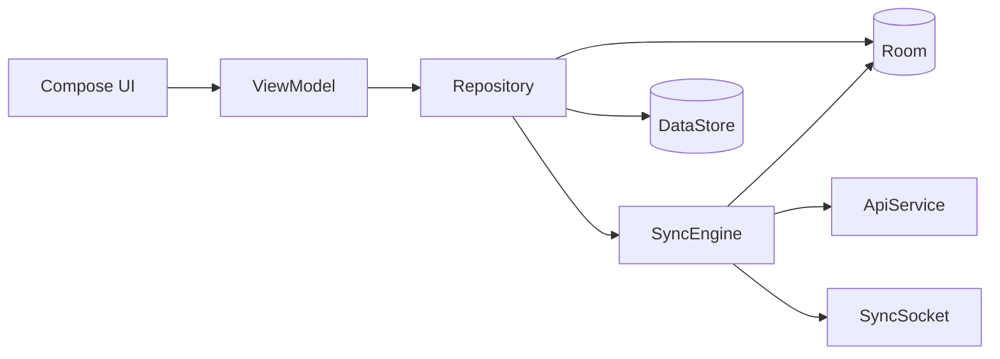

- UI 不依赖 `network` 与 `db`，只依赖 `repository` 暴露的模型与 Flow。
- Repository 不依赖 Compose。
- SyncEngine 是唯一的网络写入者；UI 与 ViewModel 不得直接发请求。
- Room 是唯一事实来源；服务端返回的数据必须写入 Room 后，UI 才能看到。

### 5.2 读路径

1. UI 订阅 Repository 暴露的 `Flow`。
2. Repository 把 Room 查询结果映射为展示模型。
3. SyncEngine 在后台把远端变更写入 Room。
4. Room 的 `Flow` 自动推送新列表，UI 重组。

### 5.3 写路径

1. 用户操作 → ViewModel → Repository。
2. Repository 在同一个 Room 事务中写本地记录并插入 Outbox。
3. UI 立即看到本地状态（乐观更新）。
4. SyncEngine 按 Outbox 顺序发送请求；成功后更新本地同步状态。
5. 服务端广播的 WS 事件或下一次增量拉取负责对齐其他设备。

### 5.4 关键不变量

- 本地记录先存在，网络请求后发生。
- 任何 UI 操作在离线时必须可用（配对、分享生成除外）。
- 本地裁剪只影响展示，不产生服务端删除。
- `lastSeq` 只能由 REST 增量拉取或连续无缺口的 WS 事件推进；HTTP 写响应中的 `serverSeq` 只写入记录，不推进 `lastSeq`。
- 同一时刻只允许一个 Outbox 处理协程与一个增量拉取协程。

## 6. 核心组件

### 6.1 Room 本地库

数据库版本 1，导出 schema，Android 与 Desktop 各自使用对应 SQLite driver。

#### 6.1.1 `clips` 表

| 列 | 类型 | 说明 |
| --- | --- | --- |
| `id` | TEXT PK | 客户端生成的 ULID |
| `content` | TEXT | 正文 |
| `sourceDeviceId` | TEXT | 来源设备 ID |
| `sourceDeviceName` | TEXT | 来源设备名；缺失时为“未知设备” |
| `pinned` | INTEGER | 0/1 |
| `createdAt` | INTEGER | 客户端创建时间，epoch 毫秒 |
| `serverSeq` | INTEGER | 服务端最后一次变更为该记录分配的序号；未同步时为 0 |
| `deleted` | INTEGER | 本地是否已删除；删除确认后物理移除 |
| `syncState` | TEXT | 见下表 |
| `lastErrorCode` | TEXT | 最近一次永久错误的错误码，可空 |
| `lastErrorAt` | INTEGER | 最近一次错误时间，可空 |

`syncState`：

| 值 | 含义 |
| --- | --- |
| `SYNCED` | 与服务端一致 |
| `PENDING_CREATE` | 本地已创建，等待 POST |
| `PENDING_UPDATE` | 本地已改置顶，等待 PATCH |
| `PENDING_DELETE` | 本地已删除，等待 DELETE |
| `FAILED_CREATE` | POST 永久失败，等待用户处理 |
| `FAILED_UPDATE` | PATCH 永久失败，等待用户处理 |
| `FAILED_DELETE` | DELETE 永久失败，等待用户处理 |

#### 6.1.2 `outbox` 表

| 列 | 类型 | 说明 |
| --- | --- | --- |
| `opId` | INTEGER PK AUTOINCREMENT | 全局顺序 |
| `clipId` | TEXT | 关联记录 |
| `opType` | TEXT | `CREATE` / `PATCH_PIN` / `DELETE` |
| `payload` | TEXT | JSON 载荷 |
| `retryCount` | INTEGER | 已重试次数 |
| `nextRetryAt` | INTEGER | 下次可执行时间，epoch 毫秒 |
| `createdAt` | INTEGER | 入队时间 |
| `lastErrorCode` | TEXT | 最近一次错误码，可空 |

#### 6.1.3 `meta` 表

| key | 说明 |
| --- | --- |
| `lastSeq` | 已应用的最后一个服务端变更序号 |
| `lastSyncAt` | 最近一次增量或全量同步成功的时间，用于设置页展示 |
| `lastFullSyncAt` | 最近一次全量同步完成时间 |
| `lastServerMaxSeq` | 最近一次看到的服务端最大序号，仅用于诊断 |

#### 6.1.4 DAO 与事务

- `ClipDao`：
  - `observeHistory(limitNonPinned = 200)`：置顶在前，组内 `createdAt DESC`，同毫秒按 `id DESC` 保证顺序稳定。
  - `search(query)`：本地内容子串匹配，忽略大小写。
  - `getById(id)`、`upsert(clip)`、`markDeleted(id)`、`deleteById(id)`。
  - `trimNonPinned(keep = 200)`：只删本地 `SYNCED` 且非置顶的旧记录，不写 Outbox。
- `OutboxDao`：
  - `enqueue(op)`、`nextDue(now)`、`delete(opId)`、`markRetry(opId, retryCount, nextRetryAt, errorCode)`。
  - `countFailed()`：用于同步状态展示。
- `MetaDao`：`get(key)`、`put(key, value)`。
- 写操作使用 `@Transaction`：本地记录与 Outbox 入队必须原子完成。

#### 6.1.5 本地保留

- 展示最近 200 条非置顶 + 全部置顶。
- 每次应用远端变更或完成 Outbox 后执行 `trimNonPinned(200)`。
- 本地裁剪不发送 DELETE，不影响服务端。
- 置顶记录永不因数量被本地裁剪。

#### 6.1.6 冲突与合并

- 远端 upsert 与本地待发记录同 ID 时：
  - 正文相同：以远端 `serverSeq` 更新，保留待发状态；若待发是 `CREATE` 且远端已存在同内容，可安全移除该 `CREATE` 操作。
  - 正文不同：保留本地待发内容，标记 `FAILED_CREATE` 并提示冲突；不得静默覆盖。
- 置顶与删除以服务端最新事件为准；本地待发操作按 Outbox 顺序继续。

### 6.2 DataStore

| key | 类型 | 说明 |
| --- | --- | --- |
| `serverUrl` | String | 服务器基地址，统一去尾斜杠 |
| `deviceToken` | String | 设备令牌，仅本地保存 |
| `deviceId` | String | 服务端返回的设备 ID |
| `deviceName` | String | 配对时提交的设备名 |
| `lastServerUrl` | String | 上次成功配对的服务器，用于变更检测 |
| `autoPaste` | Boolean | Desktop 收到远端文本自动写剪贴板，默认 true |
| `autoClipboardSend` | Boolean | Desktop 监听剪贴板上传，默认 false |
| `themeMode` | String | `system` / `light` / `dark`，默认 `system` |

- 设备令牌以明文存于应用沙箱 DataStore；v1.0.0 不引入 Keystore/钥匙串封装。风险与后续加固见 §14。
- 令牌、配对码、分享令牌不得写入日志。
- 服务器地址只允许 `https://`；本机开发允许 `http://localhost` 或 `http://127.0.0.1`。其他 `http://` 地址在设置页给出警告并拒绝保存。
- 修改服务器地址必须先解除配对；确认后清空令牌、Room 数据与 Outbox，再重新初始化容器。

### 6.3 网络层

#### 6.3.1 HTTP 客户端

- Ktor Client：
  - Android 引擎：OkHttp。
  - Desktop 引擎：CIO。
- 插件：
  - `ContentNegotiation` + `kotlinx.serialization`，`ignoreUnknownKeys = true`。
  - `DefaultRequest`：从设置读取 `serverUrl`，拼接 `/api/v1`。
  - `Auth`：Bearer 设备令牌；配对接口不带令牌。
  - `HttpTimeout`：连接 10s，请求 30s，Socket 30s。
  - `Logging`：只记录方法、路径模板、状态码、耗时；不记录请求体、响应体、令牌。
  - `WebSockets`：客户端 WS。
- 服务器地址变更时销毁并重建 `HttpClient`、`SyncEngine` 与容器，避免旧连接与旧令牌残留。

#### 6.3.2 API 服务

`shared/network/ApiService` 只做契约映射：

| 方法 | 说明 |
| --- | --- |
| `pair(code, deviceName)` | `POST /pair` |
| `sync(since, limit)` | `GET /clips` |
| `createClip(id, content, createdAt)` | `POST /clips` |
| `patchPinned(id, pinned)` | `PATCH /clips/{id}` |
| `deleteClip(id)` | `DELETE /clips/{id}` |
| `createShare(clipId, ttlSeconds, oneTime)` | `POST /shares` |

- DTO 与 `api.md` 一一对应；服务端与客户端各自维护 DTO，`api.md` 是唯一契约。
- 错误解析为 `ApiException(status, code, message, retryAfterSeconds)`。
- API 层不做自动重试；重试策略只存在于 SyncEngine。
- 创建以 `id` 为幂等键；超时后重发同一请求是安全的。

#### 6.3.3 超时与错误映射

| 情况 | 处理 |
| --- | --- |
| 连接超时 / 网络不可达 | 视为可重试网络错误 |
| 401 | 暂停同步，标记需要重新配对 |
| 400 / 409 / 413 / 415 | 永久错误，Outbox 标记失败 |
| 404（删除/置顶） | 视为服务端已不存在，按删除/失败处理 |
| 429 | 读取 `Retry-After`，延迟重试 |
| 5xx | 可重试，指数退避 |
| 解析失败 | 记录错误码 `INVALID_RESPONSE`，不崩溃，按可重试处理 |

### 6.4 WebSocket 客户端

`SyncSocket` 封装 Ktor WebSocket：

- 连接地址：`serverUrl` 转换为 `wss://`（本机开发允许 `ws://`）+ `/api/v1/sync`。
- 生命周期：
  - Android：`onStart` 连接，`onStop` 主动断开；重新前台时先 REST 补拉再连接。
  - Desktop：应用运行期间常连；窗口最小化不主动断开。
- 认证：
  1. 建立连接。
  2. 5 秒内发送 `{"type":"auth","token":"..."}`。
  3. 等待 `auth.ok`，记录 `serverSeq`。
  4. 任何错误或超时进入重连退避。
- 事件处理：
  - `clip.created` / `clip.updated`：按 `id` upsert 本地记录；若本地存在待发状态，按 §6.1.6 合并。
  - `clip.deleted`：物理删除本地记录（或标记后立即删除），推进 `lastSeq`。
  - 事件 `seq <= lastSeq`：忽略。
  - `seq == lastSeq + 1`：应用并推进。
  - `seq > lastSeq + 1`：忽略该事件，触发 REST 补拉。
- 补拉期间收到的事件先放入内存缓冲；补拉结束后按 `seq` 顺序重新处理。
- 重连退避：1s → 2s → 4s → 8s → 16s → 32s → 60s，±20% 抖动。
- 关闭码处理：
  - 4401：停止自动重连，提示重新配对。
  - 4001：停止自动重连，提示“该设备已在另一处连接”。
  - 4408 / 4429 / 1011：按退避重连。
- 单设备只允许一个活跃连接；新连接会踢掉旧连接，客户端不得两个实例互踢循环。

### 6.5 SyncEngine 与 Outbox

`SyncEngine` 是应用级单例，持有自己的 `CoroutineScope(SupervisorJob + Dispatchers.IO)`。

#### 6.5.1 状态

```kotlin
sealed interface SyncStatus {
    data object Idle : SyncStatus
    data object Syncing : SyncStatus
    data object Offline : SyncStatus
    data class Error(val code: String, val failedCount: Int) : SyncStatus
    data object Unpaired : SyncStatus
}
```

`SyncStatus` 通过 `StateFlow` 暴露给历史页与设置页。

#### 6.5.2 触发时机

- App 启动。
- Android 进入前台 / Desktop 窗口获得焦点。
- WebSocket 认证成功。
- 网络恢复（Android `ConnectivityManager` 回调；Desktop 由重试定时器兜底）。
- 用户点击“立即同步”。
- Outbox 入队后立即尝试一次。

#### 6.5.3 Outbox 处理算法

1. 若未配对，状态置 `Unpaired`，停止。
2. 使用 `Mutex` 获取同步锁；已有同步在跑则退出。
3. 读取 `nextRetryAt <= now` 的 Outbox 项，按 `opId` 升序。
4. 同一 `clipId` 的操作严格按入队顺序执行；前一个永久失败时，后续操作标记失败，不再发送。
5. 按操作类型调用 API：
   - `CREATE`：`POST /clips`；201/200 都视为成功，记录返回的 `serverSeq`。
   - `PATCH_PIN`：`PATCH /clips/{id}`；404 视为记录已不存在，标记失败。
   - `DELETE`：`DELETE /clips/{id}`；200 成功；404 视为已不存在，按成功处理。
6. 成功：更新本地记录的 `serverSeq` / `pinned` / `deleted`，移除 Outbox 项。
7. 永久错误（400 / 409 / 413 / 415）：
   - 记录 `lastErrorCode`，更新 `syncState = FAILED_*`。
   - 保留本地记录，历史项显示失败徽标，允许用户重试或删除。
   - 不自动重试；用户重试时重置 `retryCount` / `nextRetryAt`，状态改回 `PENDING_*` 并立即触发一次处理。
8. 401：暂停整个同步，状态置 `Unpaired`，提示重新配对；Outbox 保留。
9. 429：读取 `Retry-After`，更新 `nextRetryAt`，不增加永久失败计数。
10. 网络错误 / 5xx：`retryCount + 1`，`nextRetryAt = now + min(60s, 2^retryCount 秒) + 抖动`。
11. 每次成功写入后触发一次增量补拉；不要用写响应中的 `serverSeq` 推进 `lastSeq`。

#### 6.5.4 增量拉取算法

1. 若未配对，停止。
2. 读取 `lastSeq`。
3. 循环请求 `GET /clips?since=lastSeq&limit=200`：
   - 若 `resyncRequired=true`：进入全量重同步。
   - 按 `items` 顺序应用：
     - 活跃记录：upsert；保留本地待发状态时按 §6.1.6 合并。
     - 墓碑：删除本地记录（若存在）。
   - `lastSeq = nextSince`，写入 `meta`。
   - `hasMore=false` 时结束。
4. 执行 `trimNonPinned(200)`。
5. 更新同步状态为 `Idle` 或 `Offline`。

#### 6.5.5 全量重同步

1. 暂停 Outbox 与 WS 事件应用。
2. 保留 Outbox、`PENDING_*` / `FAILED_*` 记录与设置。
3. 删除所有 `SYNCED` 本地记录，`lastSeq = 0`。
4. 从 `since=0` 分页拉取直到结束。
5. 恢复 Outbox；处理完后再补拉一次。
6. 若服务端同时存在同 ID 的待发记录，按内容合并；内容不同标记冲突。

#### 6.5.6 并发规则

- 一个 `Mutex` 保护“Outbox 处理 + 增量拉取 + 全量重同步”，三者串行。
- WS 事件应用不直接改动 `lastSeq`（除连续事件外），所有缺口修复走增量拉取。
- 数据库写操作使用 Room 事务；网络请求不持有数据库事务。
- 退出应用不取消已提交的 Outbox 项；下次启动继续。

### 6.6 剪贴板服务

```kotlin
interface ClipboardService {
    suspend fun readText(): String?
    suspend fun writeText(text: String)
    fun observeTextChanges(): Flow<String>
}
```

#### 6.6.1 Android

- 使用 `ClipboardManager`。
- 只在 App 前台读取/写入；不做后台监听。
- 历史项“复制”按钮：写入剪贴板 + Toast。
- 收到远端文本不自动写入；用户打开 App 看到最新记录后一键复制。
- 透明复制 Activity 属于 P2（依赖后台通知），v1.0.0 不实现。

#### 6.6.2 Desktop

- 使用 AWT `Toolkit.getDefaultToolkit().systemClipboard`。
- 自动接收：
  - 默认开启。
  - 仅对 WebSocket 实时到达的 `clip.created` 且 `sourceDeviceId != 本机` 写入系统剪贴板；REST 补拉与 `clip.updated` 不写入，避免覆盖用户当前剪贴板。
  - 写入前记录 `lastAppliedHash` 与时间。
- 自动发送：
  - 默认关闭。
  - 开启后每 500ms 轮询剪贴板纯文本。
  - 内容非空、长度 ≤64 KiB、哈希与上次不同才处理。
  - 变化后 debounce 800ms 再上传，避免连续复制产生多条记录。
- 防回环：
  - `lastAppliedHash`：最近一次由远端写入剪贴板的内容哈希。
  - `lastSentHash`：最近一次由本机上传的内容哈希。
  - 监听读到内容哈希命中 `lastAppliedHash` 且时间窗在 2 秒内时跳过上传。
  - 上传后记录 `lastSentHash`；写远端内容后记录 `lastAppliedHash`。
- Linux/Wayland 下 `FlavorListener` 不可靠，轮询是主路径，不依赖事件。
- 内容超过 64 KiB 时跳过自动上传，并在设置页/状态栏提示一次，不反复弹窗。

#### 6.6.3 线程

- Desktop 轮询在 `Dispatchers.IO`。
- 哈希计算与文本比较在 `Dispatchers.Default`。
- 剪贴板写入在主线程/EDT；KMP 通过平台封装切换。

### 6.7 分享入口与透明复制页

#### 6.7.1 Android Manifest

```xml
<activity
    android:name=".ShareReceiverActivity"
    android:exported="true"
    android:theme="@android:style/Theme.Translucent.NoTitleBar">
    <intent-filter>
        <action android:name="android.intent.action.SEND" />
        <category android:name="android.intent.category.DEFAULT" />
        <data android:mimeType="text/plain" />
    </intent-filter>
    <intent-filter>
        <action android:name="android.intent.action.PROCESS_TEXT" />
        <category android:name="android.intent.category.DEFAULT" />
        <data android:mimeType="text/plain" />
    </intent-filter>
</activity>
```

- 不声明 `POST_NOTIFICATIONS`（v1.0.0 无通知）。
- 不声明后台剪贴板相关权限（系统也不提供）。
- `ShareReceiverActivity` 作为透明入口，不展示界面：读取分享文本后转发给 `MainActivity` 的发送页并 `finish()`；由用户在发送页确认后才写入本地库与 Outbox。
- 文本超限或缺失时，发送页展示对应提示，不自动发送。
- 未配对时按 §6.7.2 暂存草稿并跳转配对页。
- `ACTION_PROCESS_TEXT` 发送成功后返回原文本，避免替换用户选中的文本。

#### 6.7.2 未配对时分享

1. `ShareReceiverActivity` 检测到未配对。
2. 把文本暂存到进程内/DataStore 草稿。
3. 打开 `MainActivity` 并导航到配对页。
4. 配对成功后回到历史页，把草稿预填到发送框，由用户手动发送。
5. 用户取消配对时保留草稿，下次进入 App 仍可见；不自动丢弃。

#### 6.7.3 透明复制页

- 用于 Android 后台通知的“复制”按钮。
- v1.0.0 没有后台通知，因此不实现；P2 推送通道确定后与通知一起实现。
- 设计预案：透明 Activity 接收 `PendingIntent`，调用 `setPrimaryClip`，Toast，`finish()`。

### 6.8 工具箱

纯本地，不依赖网络、数据库或登录状态。

| 工具 | 实现要点 | 限制 |
| --- | --- | --- |
| JSON 格式化/压缩/校验 | `kotlinx.serialization.json.Json`；解析失败展示行/列与原因 | 输入 ≤100 KiB |
| Base64 编解码 | 标准与 URL-safe；解码失败提示非法字符位置 | 输入 ≤100 KiB |
| URL 编解码 | RFC 3986 百分号编码；区分组件编码与整段 URL | 输入 ≤100 KiB |
| 时间戳转换 | 秒/毫秒自动识别；本地时区与 UTC；输出 ISO-8601 | 输入长度 ≤32 |
| 正则测试 | 匹配高亮、分组展示、替换预览 | 输入 ≤100 KiB；计算在 `Dispatchers.Default` |

- 每个工具页包含输入区、输出区、复制、清空；输出可复制到剪贴板。
- 正则灾难性回溯无法可靠中断：v1.0.0 通过 100 KiB 输入上限与后台线程降低影响，残余风险见 §14。
- 工具箱不写入历史记录，不触发同步。

### 6.9 依赖注入

使用 Koin：

| 模块 | 提供 |
| --- | --- |
| `appModule` | `AppContainer`、协程作用域、时钟、ULID 生成器 |
| `platformModule` | `ClipboardService`、`DeviceInfo`、平台生命周期、HTTP 引擎 |
| `dataModule` | Room 数据库、DAO、DataStore、Repository |
| `syncModule` | `ApiService`、`SyncSocket`、`SyncEngine`、`OutboxWorker` |
| `viewModelModule` | 各页面 ViewModel |

- `AppContainer` 在应用启动时创建一次；服务器地址变更/解除配对后整体重建。
- ViewModel 使用 `koinViewModel()` 注入。
- 不在 Composable 中直接构造 Repository 或 HttpClient。

## 7. UI、导航与状态

### 7.1 路由

| 路由 | 页面 | 说明 |
| --- | --- | --- |
| `history` | 历史（首页） | 发送框、同步状态、搜索、记录列表 |
| `toolbox` | 工具箱 | 5 个工具入口网格 |
| `toolbox/{toolId}` | 工具详情 | 对应工具输入/输出 |
| `settings` | 设置 | 服务器、配对、开关、主题、关于 |
| `pairing` | 配对 | 首次启动或未配对时进入 |

- 自适应布局：宽度 <600dp 使用底部导航栏；≥600dp 使用左侧 NavigationRail。
- Desktop 与 Android 共享路由与页面；平台差异通过 `expect/actual` 注入。
- 未配对时历史页显示空状态与“去配对”按钮，不阻塞工具箱。

### 7.2 历史页

- 顶部：标题、同步状态、搜索图标。
- 发送区：多行输入框 + 发送按钮；显示 UTF-8 字节数，超过 90% 时提示，超过 64 KiB 禁止发送。
- 列表：
  - 置顶组在前，组内按 `createdAt DESC`；非置顶组同样倒序。
  - 每项展示最多 3 行正文预览、来源设备、相对时间（超过 24 小时显示绝对时间）。
  - 操作：复制、置顶/取消置顶、删除、生成分享链接。
  - 失败项显示错误徽标与“重试/删除”入口。
- 搜索：
  - 仅本地内容子串匹配，忽略大小写，300ms 防抖。
  - 搜索时置顶排序仍然生效。
- 删除：二次确认对话框；不提供撤销（v1.0.0 无恢复接口）。
- 分享动作只在记录 `SYNCED` 时可用；待同步/离线时置灰并提示“同步后可分享”。

### 7.3 配对页

- 服务器地址输入（首次可预填 `https://`）。
- 6 位配对码输入。
- 设备名输入，默认 `Android · <型号>` / `Desktop · <系统>`，可编辑。
- 配对成功：保存令牌、设备信息，触发首次全量同步，返回历史页。
- 失败：按错误码展示中文提示；配对码错误/过期/已用分别提示。
- 配对中禁用重复提交。

### 7.4 设置页

| 分组 | 项 |
| --- | --- |
| 服务器 | 地址、连接状态、立即同步 |
| 设备 | 设备名、配对状态、解除配对 |
| Desktop 剪贴板 | 自动写入（默认开）、自动上传（默认关） |
| 外观 | 主题（跟随系统/浅色/深色） |
| 关于 | 版本、构建类型、开源许可、API 版本、数据与隐私说明 |

- 修改服务器地址：提示“将解除配对并清空本地数据”，确认后执行。
- 解除配对：二次确认；清空令牌、Room 数据、Outbox；服务端设备记录保留（撤销属 P2）。
- 立即同步：触发 Outbox + 增量拉取；显示进度与结果。
- v1.0.0 仅简体中文 UI。

### 7.5 状态与事件

- 每个页面一个 `UiState`，通过 `StateFlow` 暴露，UI 使用 `collectAsStateWithLifecycle()`。
- 一次性事件（Toast、导航）使用 `Channel` / `SharedFlow`，不塞进 `UiState`。
- 所有列表来自 Room `Flow`；ViewModel 不缓存可变列表副本。
- 错误状态包含稳定错误码与可展示文案；文案在 UI 层映射，不在 Repository 硬编码。

### 7.6 主题与可访问性

- Material 3；默认跟随系统深浅色。
- 触控目标 ≥48dp；正文预览与操作按钮提供 contentDescription。
- 历史列表使用 `LazyColumn` + 稳定 key（`id`），避免重组错位。

## 8. 关键时序

### 8.1 配对

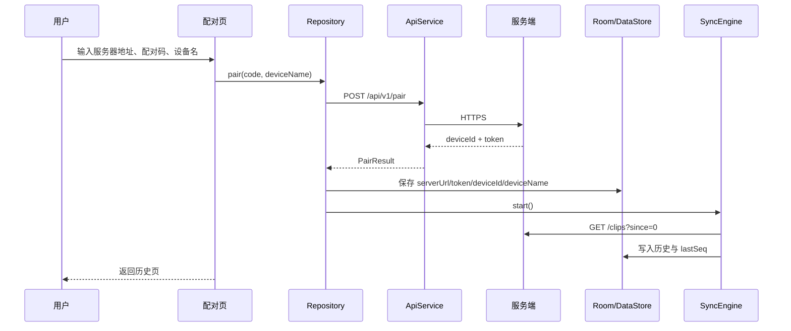

### 8.2 Android 分享发送

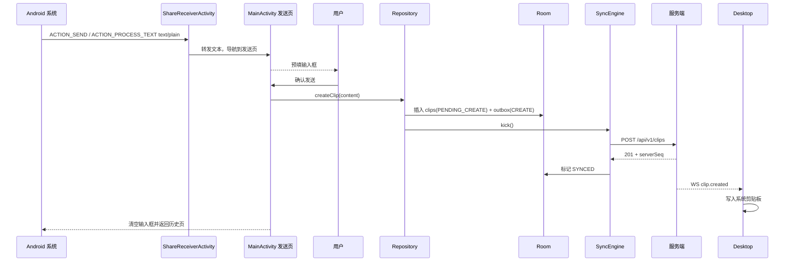

### 8.3 前台同步与 WS 补拉

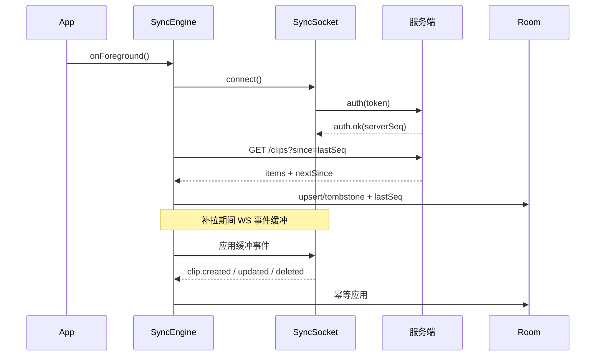

### 8.4 桌面收到远端文本并写剪贴板

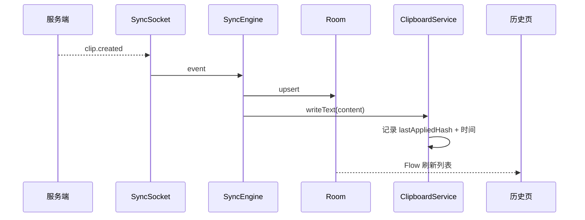

### 8.5 离线置顶/删除

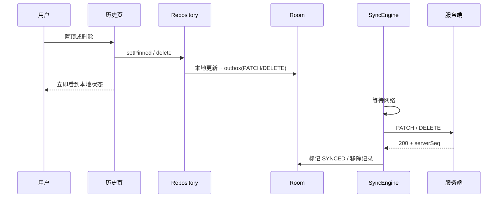

### 8.6 Outbox 重试

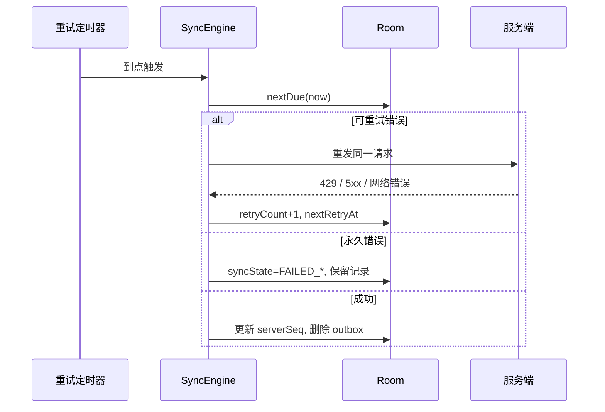

## 9. 状态机

### 9.1 同步状态

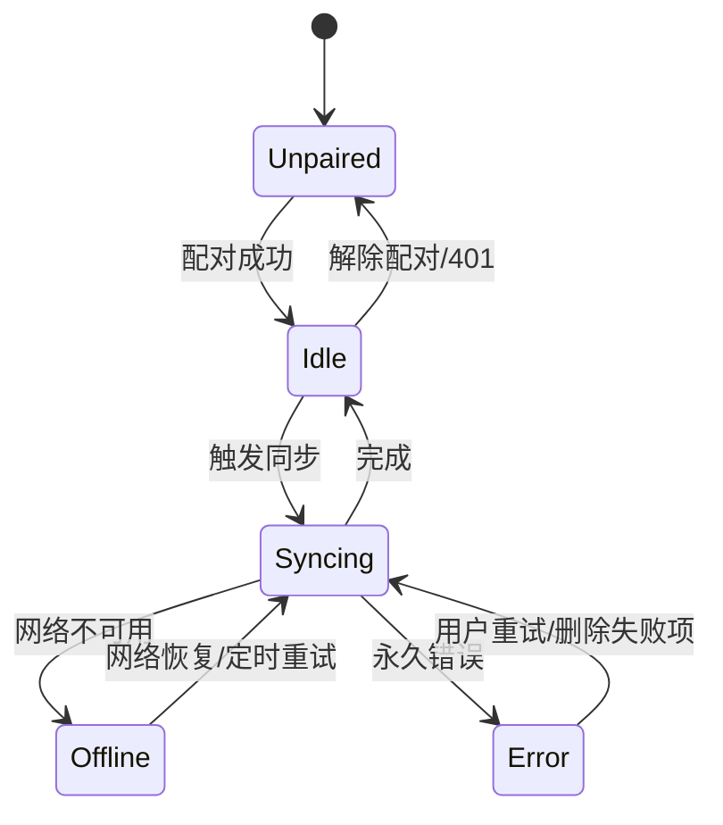

### 9.2 WebSocket 连接

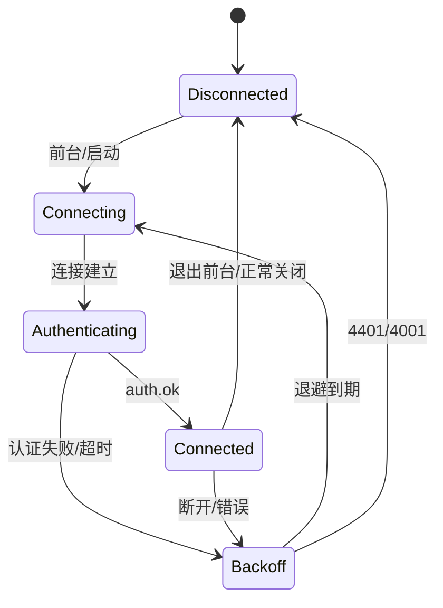

### 9.3 Outbox 项

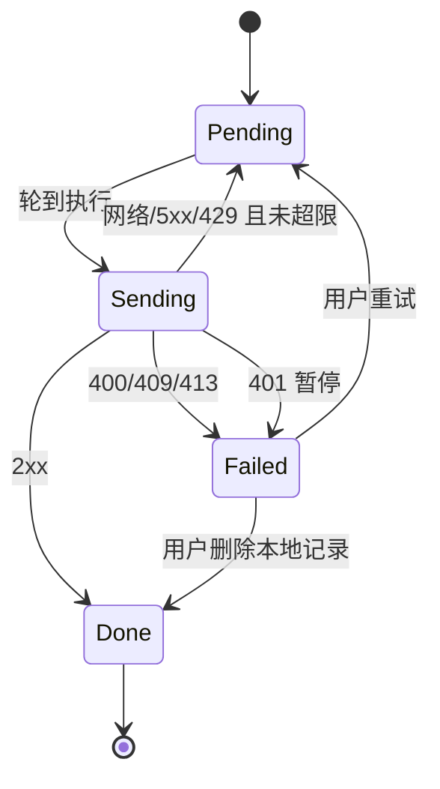

## 10. 平台差异矩阵

| 能力 | Android | Desktop |
| --- | --- | --- |
| 系统分享入口 | `ACTION_SEND` / `ACTION_PROCESS_TEXT` | 无，窗口输入框 |
| 剪贴板读取 | 仅前台 | 常驻，可轮询 |
| 剪贴板写入 | 用户点击复制 | 可自动写入（默认开） |
| 自动上传剪贴板 | 不支持 | 可开启（默认关） |
| WebSocket | 仅前台 | 运行期间常连 |
| 后台通知 | v1.0.0 无 | 无 |
| 透明复制页 | P2 | 不适用 |
| 托盘/全局快捷键 | 不适用 | P2 |
| 最低版本 | Android 8.0 / API 26 | Windows / macOS / Linux，JRE 21 |
| 窗口尺寸 | 全屏 | 默认 1000×700，最小 640×480 |

## 11. 错误处理与用户提示

| 错误 | 用户提示 | 系统行为 |
| --- | --- | --- |
| 网络不可用 | 当前离线，恢复后自动同步 | 记录保留在 Outbox，指数退避 |
| 401 | 登录已失效，请重新配对 | 暂停同步，保留本地数据 |
| 400 / 413 | 正文不合规（400）或请求体超限（413） | 记录标记失败，允许重试/删除 |
| 409 | 同步冲突，请删除后重试 | 记录标记失败，不覆盖 |
| 429 | 操作过于频繁，请稍后重试 | 按 `Retry-After` 延迟 |
| 404（删除/置顶） | 记录已不存在 | 本地按删除处理 |
| 分享过期/已焚毁 | 分享链接已失效 | 展示服务端错误页 |
| 配对码错误/过期/已用 | 对应中文提示 | 允许重新输入，不清空设备名 |
| 剪贴板写入失败 | 复制失败，请重试 | 记录日志，不影响历史 |
| 正则执行过久 | 输入过大或表达式过于复杂 | 后台线程结束/放弃，不阻塞 UI |

- 日志：只记录错误码、操作类型、记录 ID、耗时；不记录正文、令牌、配对码、分享令牌。
- 永久失败项在历史页显示徽标，点击可查看错误码与“重试/删除”。

## 12. 性能与资源预算

| 指标 | 目标 |
| --- | --- |
| 手机分享到桌面剪贴板 | ≤5 秒（正常网络） |
| 桌面发送到手机可见 | ≤3 秒（App 打开/前台） |
| 本地搜索 200 条 | <100ms |
| 历史列表滚动 | 60fps，无明显卡顿 |
| 本地数据库 | 200 条 + Outbox，通常 <5MB |
| WebSocket 重连 | 网络恢复后 ≤5 秒进入 Connected |
| 工具箱 100 KiB 文本 | 不阻塞主线程 |
| 冷启动 | 以中端 Android 设备可接受为准，v1.0.0 不设硬性毫秒指标 |

- 历史列表只查询展示所需字段，正文预览在 SQL/映射层截断，不把 64 KiB 全文传给 UI。
- 搜索与裁剪在 IO 线程；正则、哈希在 Default 线程。
- WS 事件逐条应用，批量补拉使用事务批量 upsert，减少重组次数。

## 13. 测试策略

| 层级 | 范围 | 工具 |
| --- | --- | --- |
| 单元测试 | SyncEngine 状态迁移、Outbox 重试、冲突合并、剪贴板回环、字节数、ULID、搜索转义 | Kotlin Test / JUnit |
| 集成测试 | Room 事务与裁剪、Ktor MockEngine 的 API 映射、WS 缺口处理 | Ktor MockEngine、Room 测试库 |
| UI 测试 | 历史列表、搜索、配对表单、分享弹窗、设置 | Compose UI Test（关键路径） |
| 真机手测 | Android 分享/选中菜单/前台同步/复制；Desktop 剪贴板自动写/自动上传/防回环；WS 断线重连；离线恢复 | 真实设备 |

关键测试用例：

1. 离线创建 3 条 → 重启 App → 联网后按序上传，服务端无重复。
2. 服务端返回 201 但响应丢失 → Outbox 重发同 ID → 返回 200，本地不重复。
3. WS 事件 seq 跳号 → 触发补拉，最终 `lastSeq` 连续。
4. 服务端 `resyncRequired` → 清空已同步记录、保留 Outbox、全量拉取。
5. 远端删除墓碑 → 本地记录消失，置顶记录不受影响。
6. Desktop 自动写入后监听不回声上传。
7. 64 KiB 边界正文可发送，64 KiB+1 被拒绝。
8. 搜索包含 `%` / `_` 的内容不误匹配。
9. 401 → 暂停同步，重新配对后 Outbox 恢复。
10. 未配对分享 → 草稿保留 → 配对成功后预填发送框。

## 14. 风险与应对

| 风险 | 影响 | 应对 |
| --- | --- | --- |
| Room KMP / Ktor / CMP 版本适配 | 构建不稳定 | 以 KMP 模板锁定版本，升级单独验证 |
| Linux/Wayland 剪贴板监听差异 | 自动上传失灵 | 500ms 轮询 + 哈希去重为主路径 |
| OEM 后台限制 | 前台同步/WS 不稳定 | v1.0.0 不依赖后台；前台补拉兜底；P2 再评估推送 |
| 正则灾难性回溯 | 工具页卡顿 | 100 KiB 上限 + 后台线程；残余风险接受 |
| 设备令牌明文存储 | 设备被物理攻破时令牌泄露 | 应用沙箱 + 不写日志；P2 评估 Keystore/钥匙串 |
| 服务端明文存储 | 服务器被攻破时正文泄露 | 自用单用户；HTTPS；P2 评估端到端加密 |
| 解除配对清空本地数据 | 用户误操作丢历史 | 二次确认；文案明确 |
| WS 事件丢失 | 实时性下降 | REST `since` 补拉是最终一致性保障 |
| 设备时钟偏差 | 历史排序异常 | `serverSeq` 负责同步顺序；`createdAt` 仅展示 |
| 本地数据库损坏 | 历史丢失 | 服务端保留 500 条，可全量重同步；备份不在客户端范围 |

## 15. 与交接文档 v0.1 的差异

| 项 | 交接文档 v0.1 | v1.0.0 | 原因 |
| --- | --- | --- | --- |
| 工程目录 | 单根 `clipbox/` 含 composeApp/shared/server | `ClipboxClient/` 与 `ClipboxServer/` 分开 | 当前工作区结构，服务端独立构建 |
| 增量同步 | `after` ULID 游标 | `since` + `serverSeq` | ADR-0001 |
| 历史翻页 | 服务端 `before` 翻页 | 本地历史，无服务端翻页 | 本地库为唯一数据源 |
| 分享页 | `clip_id` 引用 | 内容快照 + token 哈希 | ADR-0002 |
| 透明复制页 | MVP 界面清单 | P2 | v1.0.0 无后台通知，无触发入口 |
| 推送/收藏夹/托盘 | P1/P2 | 不进 v1.0.0 | 范围与里程碑对齐 |
| 本地保留 | 最近 200 条 | 最近 200 条非置顶 + 全部置顶 | 置顶是显式保值操作 |
| Outbox 失败 | 仅指数退避 | 区分可重试/永久/401/429 | 避免无限重试与日志噪音 |
| 未配对分享 | 未定义 | 草稿 + 配对后预填 | 避免用户选中文本丢失 |
| 请求体上限 | 128 KiB | 512 KiB | 覆盖 JSON 转义最坏膨胀 |
| UI 语言 | 未定义 | 仅简体中文 | v1.0.0 范围控制 |
| 设备来源名 | 仅 source_device_id | API 返回 sourceDeviceName | 历史列表直接展示 |

## 16. 变更记录

| 版本 | 日期 | 变更 |
| --- | --- | --- |
| v1.0.0 | 2026-11-13 | 初版：基于交接文档 v0.1、api.md、ADR-0001、ADR-0002 冻结客户端架构 |
