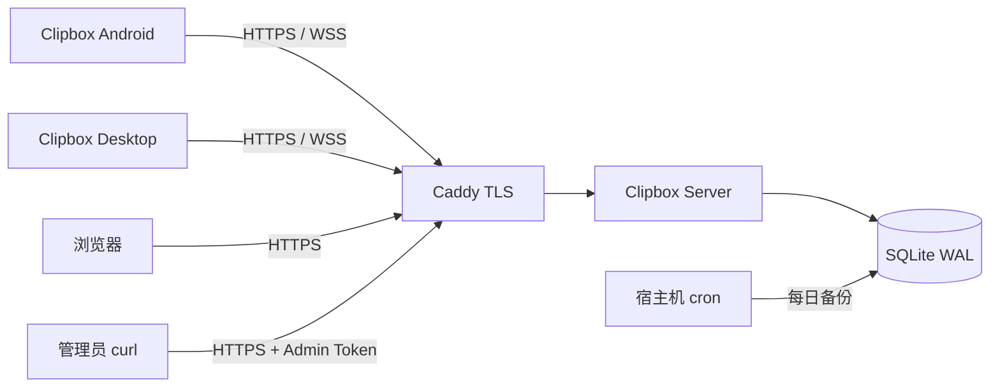
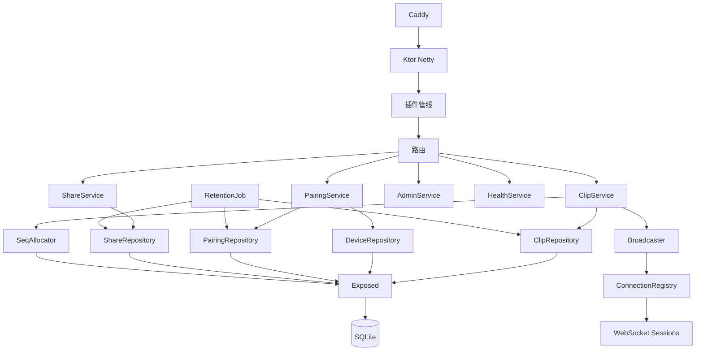
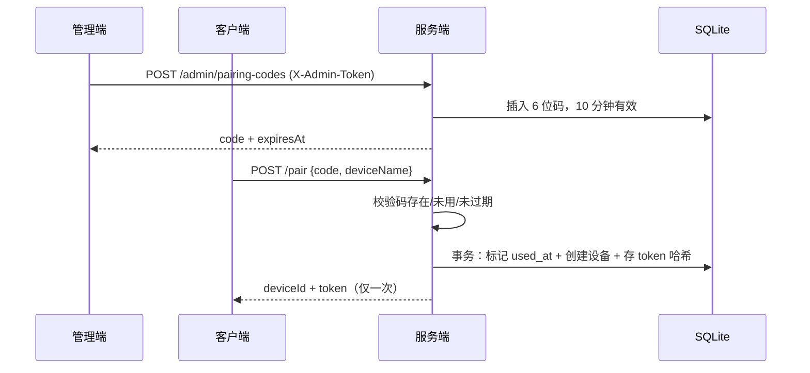
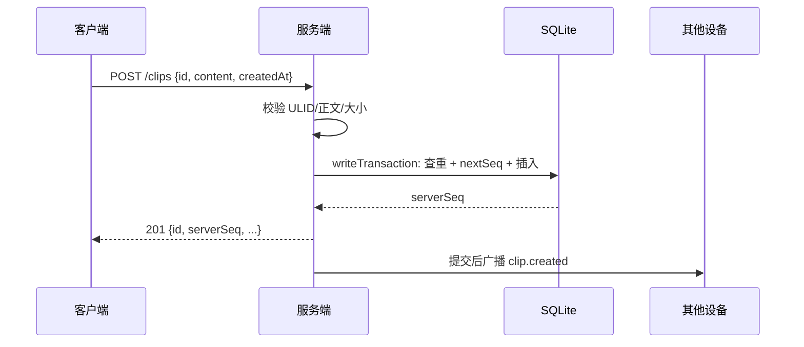
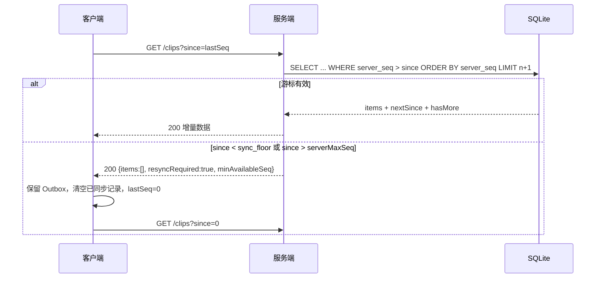
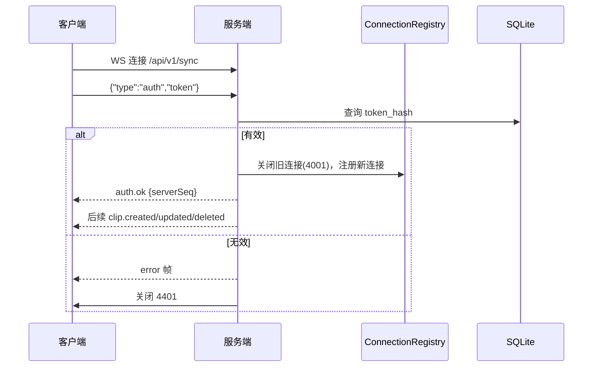
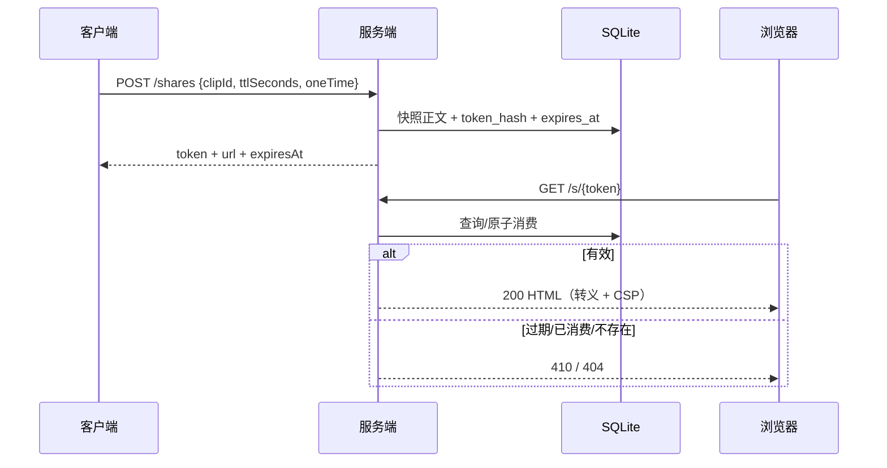
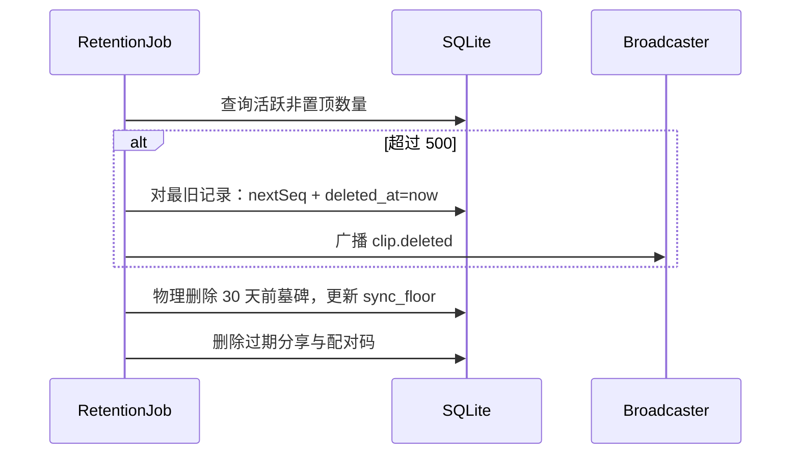

# Clipbox 服务端技术架构 v1.0.0

| 字段 | 内容 |
| --- | --- |
| 文档版本 | v1.0.0 |
| 更新日期 | 2026-11-13 |
| 状态 | 设计冻结，作为服务端实现依据 |
| 基线 | [Clipbox 项目交接文档](./Clipbox%20项目交接文档.md) v0.1 |
| 接口契约 | [api.md](./api.md) |
| 术语 | [GLOSSARY.md](GLOSSARY.md) |
| 适用产品 | Clipbox v1.0.0，单实例 Docker 部署 |

## 1. 目标与范围

服务端是单用户、多设备场景下的同步中枢：

- 设备配对与令牌签发。
- 剪贴记录的创建、置顶、软删除与变更同步。
- WebSocket 实时广播。
- 一次性只读分享页。
- 数据保留、清理、备份与健康检查。

服务端不承担：

- 图片、文件、音视频存储或传输。
- 多用户注册、开放平台、社交分享。
- 服务端 AI 推理。
- 端到端加密（P2 评估）。
- 高可用与水平扩展（单实例，靠备份与客户端离线队列兜底）。

## 2. 约束

| 约束 | 影响 |
| --- | --- |
| 2 核 CPU / 2GB 内存 / 3Mbps 带宽 | 只传文本；JVM `-Xmx256m`；单实例 |
| SQLite 单文件 | 单写者；WAL；备份简单；不做复杂查询 |
| 单实例 | 限流与 WebSocket 注册表可放内存；不支持水平扩展 |
| 单用户 | 不需要 users 表；设备即身份 |
| 公网暴露 | 必须 HTTPS/WSS；配对码与管理接口必须限流 |
| 数据量小 | 500 条剪贴 + 30 天墓碑；存储通常 <10MB |

## 3. C4 上下文与容器视图

### 3.1 C4 L1：系统上下文



### 3.2 C4 L2：服务端容器



| 容器 | 职责 |
| --- | --- |
| Caddy | TLS 终止、反向代理、HSTS、可选管理路径 IP 限制 |
| Ktor Netty | HTTP/WS 入口、插件管线、路由 |
| Exposed | SQLite 访问、事务、表映射 |
| SQLite | 设备、剪贴、配对码、分享、元数据 |
| ConnectionRegistry | 单设备单连接的 WebSocket 注册表 |
| Broadcaster | 事务提交后的实时事件广播 |
| RetentionJob | 保留清理、墓碑清理、分享与配对码清理 |

## 4. 工程结构

```text
ClipboxServer/
├── build.gradle.kts
├── Dockerfile
├── src/main/kotlin/dev/qoder/clipbox/server/
│   ├── Application.kt                  # main、插件装配、路由装配、启动任务
│   ├── config/
│   │   └── AppConfig.kt                # 环境变量读取与启动校验
│   ├── plugins/
│   │   ├── Serialization.kt            # JSON
│   │   ├── Monitoring.kt               # CallLogging、RequestId
│   │   ├── StatusPages.kt              # 统一错误映射
│   │   ├── RequestLimits.kt            # 请求体大小限制
│   │   ├── RateLimits.kt               # IP/设备限流
│   │   ├── Security.kt                 # 认证、安全响应头
│   │   └── WebSockets.kt               # WS 配置
│   ├── api/                            # 请求/响应 DTO
│   ├── auth/
│   │   ├── DeviceAuth.kt
│   │   ├── AdminAuth.kt
│   │   ├── PairingService.kt
│   │   └── TokenHasher.kt
│   ├── routes/
│   │   ├── PairRoutes.kt
│   │   ├── ClipRoutes.kt
│   │   ├── SyncRoutes.kt
│   │   ├── ShareRoutes.kt
│   │   ├── AdminRoutes.kt
│   │   ├── SharePageRoutes.kt
│   │   └── HealthRoutes.kt
│   ├── db/
│   │   ├── DatabaseFactory.kt
│   │   ├── Migrator.kt
│   │   ├── Tables.kt
│   │   ├── ClipRepository.kt
│   │   ├── DeviceRepository.kt
│   │   ├── PairingRepository.kt
│   │   ├── ShareRepository.kt
│   │   ├── MetaRepository.kt
│   │   └── SeqAllocator.kt
│   ├── sync/
│   │   ├── ChangeFeed.kt
│   │   ├── Broadcaster.kt
│   │   ├── ConnectionRegistry.kt
│   │   └── SyncEvent.kt
│   ├── share/
│   │   ├── ShareService.kt
│   │   └── SharePageRenderer.kt
│   ├── cleanup/
│   │   └── RetentionJob.kt
│   └── util/
│       ├── Ulid.kt
│       ├── Time.kt
│       ├── Hashing.kt
│       └── Errors.kt
└── src/main/resources/
    ├── application.conf
    ├── logback.xml
    └── migrations/
        └── V001__init.sql
```

- 服务端是独立 Gradle 工程，不依赖客户端 `shared`。API DTO 两端各自维护，`api.md` 是唯一契约；服务端集成测试使用 `api.md` 的示例做契约校验。
- 不拆多模块：单 `server` 工程 + 包分层，规模与单人维护匹配。

## 5. 请求管线

### 5.1 插件顺序

```text
Caddy TLS
  → Ktor Netty
  → XForwardedHeaders（只信任 Caddy）
  → RequestId + CallLogging（脱敏）
  → StatusPages（统一错误）
  → ContentNegotiation（JSON）
  → RequestBodyLimit（512 KiB）
  → RateLimit（IP 维度）
  → Routing
      ├─ 公开路由：/api/v1/pair、/s/{token}、/healthz
      ├─ 设备认证路由：/api/v1/clips、/api/v1/shares
      ├─ 管理认证路由：/api/v1/admin/pairing-codes
      └─ WebSocket：/api/v1/sync
  → 参数校验 → Service → 事务 → 提交 → 广播 → 响应
```

### 5.2 认证

| 类型 | 实现 |
| --- | --- |
| 设备 | Ktor Bearer 认证：解析 `Authorization`，SHA-256 后查 `devices.token_hash`；附加 `DevicePrincipal(deviceId, name)` |
| 管理 | 自定义路由拦截：`X-Admin-Token` 与 `ADMIN_TOKEN` 常量时间比较 |
| 公开 | 不认证；仅限配对、分享页、健康检查 |

- 设备认证成功后更新 `last_seen_at`，同一设备最多每 5 分钟写一次，避免每个请求都产生写事务。
- 认证失败统一返回 401，不区分“令牌不存在”和“令牌格式错误”。

### 5.3 请求体与参数限制

- `RequestBodyLimit` 限制请求体 512 KiB，超限返回 JSON 413。
- 正文进入业务层后按 UTF-8 字节数校验 64 KiB。
- 设备名去除首尾空白后 1–64 字符。
- 配对码必须匹配 `^\d{6}$`。
- 分享 TTL 60–604800 秒。
- 同步 `limit` 1–500；`since` 非负。
- JSON 解析忽略未知字段；缺失必填字段返回 400。

### 5.4 统一错误映射

```text
AppException(status, code, message)
  → StatusPages → {"error":{"code","message"}}

IllegalArgumentException / 校验失败
  → 400 VALIDATION_ERROR

未捕获异常
  → 500 INTERNAL_ERROR，服务端记录堆栈，响应不泄露细节

SQLite busy / 暂时不可用
  → 503 SERVICE_UNAVAILABLE
```

- 404 路由、405 方法不允许、415 内容类型不支持分别映射到对应错误码。
- 所有错误响应带 `X-Request-Id`。

## 6. 数据模型与存储

### 6.1 SQLite 配置

启动时对每个连接执行：

```sql
PRAGMA journal_mode = WAL;
PRAGMA synchronous = NORMAL;
PRAGMA foreign_keys = ON;
PRAGMA busy_timeout = 5000;
PRAGMA cache_size = -16000;
PRAGMA temp_store = MEMORY;
```

- 数据文件：`${DATA_DIR}/clipbox.db`（含 `-wal`、`-shm`）。
- 连接池：HikariCP，最大 4 个连接；所有写事务由 JVM `Mutex` 串行化，SQLite 仍是单写者。
- 单实例是硬约束：多实例会破坏序号分配、限流与 WebSocket 注册表。

### 6.2 Schema

`V001__init.sql`：

```sql
CREATE TABLE schema_version (
  version    INTEGER PRIMARY KEY,
  applied_at INTEGER NOT NULL
);

CREATE TABLE devices (
  id           TEXT PRIMARY KEY,
  name         TEXT NOT NULL,
  token_hash   TEXT NOT NULL UNIQUE,
  created_at   INTEGER NOT NULL,
  last_seen_at INTEGER
);

CREATE TABLE clips (
  id               TEXT PRIMARY KEY,
  content          TEXT NOT NULL,
  source_device_id TEXT,
  pinned           INTEGER NOT NULL DEFAULT 0 CHECK (pinned IN (0, 1)),
  created_at       INTEGER NOT NULL,
  deleted_at       INTEGER,
  server_seq       INTEGER NOT NULL,
  FOREIGN KEY (source_device_id) REFERENCES devices(id) ON DELETE SET NULL
);

CREATE UNIQUE INDEX idx_clips_server_seq ON clips(server_seq);
CREATE INDEX idx_clips_created_at ON clips(created_at);
CREATE INDEX idx_clips_retention ON clips(pinned, deleted_at, created_at);

CREATE TABLE pairing_codes (
  code       TEXT PRIMARY KEY,
  created_at INTEGER NOT NULL,
  expires_at INTEGER NOT NULL,
  used_at    INTEGER
);

CREATE INDEX idx_pairing_expires ON pairing_codes(expires_at);

CREATE TABLE shares (
  token_hash TEXT PRIMARY KEY,
  clip_id    TEXT NOT NULL,
  content    TEXT NOT NULL,
  created_at INTEGER NOT NULL,
  expires_at INTEGER NOT NULL,
  one_time   INTEGER NOT NULL DEFAULT 0 CHECK (one_time IN (0, 1)),
  opened_at  INTEGER
);

CREATE INDEX idx_shares_expires ON shares(expires_at);

CREATE TABLE meta (
  key   TEXT PRIMARY KEY,
  value TEXT NOT NULL
);

INSERT INTO meta(key, value) VALUES ('server_seq', '0');
INSERT INTO meta(key, value) VALUES ('sync_floor', '0');
```

- `shares.clip_id` 不设外键：分享是内容快照，必须能在剪贴记录被物理清理后继续存在（ADR-0002）。
- `clips.source_device_id` 使用 `ON DELETE SET NULL`：P2 设备删除后历史仍可显示“未知设备”。
- `clips.server_seq` 唯一索引保证变更序号不重复；每次创建、置顶变化、删除都会分配新序号，旧序号被释放。
- 正文大小、空白校验在应用层完成；SQLite 的 TEXT 存储 UTF-8。
- 不存正文哈希用于幂等比较：记录量小，直接比较正文更简单、无哈希碰撞语义。

### 6.3 `serverSeq` 分配

`meta.server_seq` 保存已分配的最大序号：

```kotlin
// 在同一个写事务内调用
fun nextSeq(): Long {
    val current = metaRepo.get("server_seq").toLong()
    val next = current + 1
    metaRepo.put("server_seq", next.toString())
    return next
}
```

写事务统一入口：

```kotlin
private val writeMutex = Mutex()

suspend fun <T> writeTransaction(block: Transaction.() -> T): T =
    writeMutex.withLock {
        newSuspendedTransaction(Dispatchers.IO, dataSource) {
            block()
        }
    }
```

- 序号分配与数据写入必须在同一个 `writeTransaction` 内；不能先分配序号再另开事务写数据。
- 单实例 + JVM `Mutex` + SQLite 单写者，保证序号严格递增且不重复。
- 写事务内不做网络发送；广播在事务提交后执行。

### 6.4 变更流与同步查询

`GET /api/v1/clips?since=&limit=` 的查询：

```sql
SELECT c.id, c.content, c.source_device_id, d.name AS source_device_name,
       c.pinned, c.created_at, c.deleted_at, c.server_seq
FROM clips c
LEFT JOIN devices d ON d.id = c.source_device_id
WHERE c.server_seq > :since
ORDER BY c.server_seq ASC
LIMIT :limit_plus_one;
```

- 取 `limit + 1` 判断 `hasMore`，返回前 `limit` 条。
- `nextSince` 为本页最后一条的 `server_seq`；空页等于请求 `since`。
- 活跃记录返回完整字段；`deleted_at IS NOT NULL` 的记录只返回 `id`、`serverSeq`、`deleted: true`，不返回正文。
- `sourceDeviceName` 为 `COALESCE(d.name, '未知设备')`。
- `serverMaxSeq = meta.server_seq`，`minAvailableSeq = meta.sync_floor + 1`。
- `resyncRequired`：
  - `since > 0 && since < sync_floor`：游标早于墓碑清理边界；
  - `since > serverMaxSeq`：服务端数据被恢复/重置，客户端游标来自“未来”。
- `resyncRequired=true` 时固定返回空 `items`、`nextSince=since`、`hasMore=false`，客户端自行全量重同步。
- `since=0` 为首次全量同步，不做 `resyncRequired` 判断；返回当前所有活跃记录与保留中的墓碑。

为什么不需要变更历史表：

- 每条记录只保留最后一次变更的 `server_seq`；客户端按 id upsert，天然只关心最新状态。
- 墓碑在 30 天内保留，覆盖离线删除；更久的离线客户端走全量重同步。
- 不需要回放中间状态，也不需要事件溯源。

### 6.5 保留与清理

`RetentionJob` 启动时运行一次，之后每 24 小时运行一次。所有清理写操作都走 `writeTransaction`，单批最多 50 条，避免长事务。

#### 6.5.1 剪贴记录保留

1. 统计 `deleted_at IS NULL AND pinned = 0` 的记录数。
2. 若超过 500 条，按 `created_at ASC` 选出超出的最旧记录。
3. 对每条记录分配新 `server_seq`，写入 `deleted_at = now`（软删除），而不是直接物理删除。
4. 软删除会产生 `clip.deleted` 广播，离线客户端可通过 `since` 补拉。

为什么先软删除：

- 置顶记录可能在取消置顶后变成“旧记录”，直接物理删除会让离线客户端永远保留它。
- 软删除 + 30 天墓碑让所有离线设备都有机会看到删除。
- 数据量小，墓碑成本可忽略。

#### 6.5.2 墓碑清理

1. 选出 `deleted_at < now - 30 天` 的墓碑，单批 100 条。
2. 记录本批最大 `server_seq`。
3. 物理删除这些行。
4. 更新 `meta.sync_floor = max(sync_floor, 本批最大 server_seq)`。

`sync_floor` 只由墓碑清理推进；软删除本身不推进，因为软删除的变更仍然可拉取。

#### 6.5.3 分享清理

- 删除 `expires_at < now - 24 小时` 的分享。
- 删除 `one_time = 1 AND opened_at < now - 24 小时` 的分享。
- 分享页在过期/消费后立即返回 410，不依赖清理任务。

#### 6.5.4 配对码清理

- 删除 `expires_at < now - 24 小时` 的配对码（无论是否使用）。
- 未过期但已使用的配对码保留到过期后 24 小时，便于排查。

#### 6.5.5 保留不变量

- 清理后活跃非置顶记录 ≤500；置顶不受数量限制。
- 墓碑保留 30 天。
- 客户端本地展示 200 条非置顶 + 全部置顶；服务端保留量始终更大。
- 服务端不物理删除活跃记录，只通过“软删除 → 墓碑 → 物理清理”路径移除。

### 6.6 迁移

- `schema_version` 表记录已应用版本。
- 迁移脚本位于 `resources/migrations/V001__init.sql`、`V002__...`，按版本号升序执行。
- 启动时：
  1. 创建 `schema_version`（若不存在）。
  2. 读取已应用最大版本。
  3. 对每个更高版本，在事务内执行脚本并插入版本记录。
  4. 任何失败立即退出，不启动服务。
- 升级前必须备份；迁移不做自动回滚，回滚依赖备份恢复。
- `V001__init.sql` 包含建表、索引与 `meta` 初始值。

### 6.7 备份

- 宿主机 cron 每日执行：
  ```bash
  sqlite3 /opt/clipbox/data/clipbox.db ".backup '/opt/clipbox/backup/clipbox-$(date +%F).db'"
  chmod 600 /opt/clipbox/backup/*.db
  find /opt/clipbox/backup -name 'clipbox-*.db' -mtime +7 -delete
  ```
- 备份文件权限 600，目录 700。
- 每季度至少做一次恢复演练：停服、替换 DB、启动、核对记录数与配对状态。
- WAL 模式下 `.backup` 是安全的一致性备份；不要直接 `cp` 正在写入的 DB。

## 7. 接口层设计

### 7.1 REST 路由

完整契约见 [api.md](./api.md)。实现映射：

| 路由 | 认证 | 服务 |
| --- | --- | --- |
| `POST /api/v1/pair` | 无 | `PairingService.pair` |
| `POST /api/v1/admin/pairing-codes` | Admin | `PairingService.createCode` |
| `GET /api/v1/clips` | Device | `ClipService.sync` |
| `POST /api/v1/clips` | Device | `ClipService.create` |
| `PATCH /api/v1/clips/{id}` | Device | `ClipService.setPinned` |
| `DELETE /api/v1/clips/{id}` | Device | `ClipService.delete` |
| `POST /api/v1/shares` | Device | `ShareService.create` |
| `GET /s/{token}` | 无 | `ShareService.open` |
| `GET /healthz` | 无 | `HealthService.check` |
| `WS /api/v1/sync` | 首帧 | `SyncRoutes.socket` |

### 7.2 剪贴写入

`ClipService.create`：

1. 校验 ULID、正文、`createdAt`。
2. `writeTransaction`：
   - 查询同 `id` 记录。
   - 不存在：`nextSeq()`，插入，`pinned=false`，`deleted_at=null`。
   - 存在且正文相同且未删除：返回既有记录（200）。
   - 存在但正文不同或已删除：抛 `CONFLICT`。
3. 仅首次创建（201）在提交后广播 `clip.created`；幂等命中（200）不广播、不推进序号。
4. 返回 201/200。

`ClipService.setPinned`：

1. `writeTransaction` 查询记录；不存在或已删除 → 404。
2. 值相同 → 返回既有 `serverSeq`，不广播。
3. 值不同 → `nextSeq()`，更新，提交后广播 `clip.updated`。

`ClipService.delete`：

1. `writeTransaction` 查询记录；不存在 → 404。
2. 已删除 → 返回既有 `serverSeq`，不重复广播。
3. 未删除 → `nextSeq()`，写 `deleted_at`，提交后广播 `clip.deleted`。

### 7.3 WebSocket

`SyncRoutes.socket`：

1. 接受连接，启动 5 秒认证超时。
2. 读取首帧 `{"type":"auth","token"}`。
3. 校验令牌：
   - 失败：发送 `error` 帧，关闭 4401。
   - 成功：关闭该设备旧连接（4001），注册新连接，发送 `auth.ok`（携带当前 `serverSeq`）。
4. 保持连接；服务端每 30 秒 ping，15 秒未收到 pong 视为断开。
5. 连接关闭时从注册表移除；不得在关闭回调中阻塞。

`Broadcaster`：

- `ClipService` 在事务提交后构造 `SyncEvent`，调用 `Broadcaster.publish(event)`。
- `publish` 遍历当前所有已认证连接，序列化 JSON 并发送；单个发送失败只移除该连接，不影响其他连接。
- 广播不持久化；失败由客户端 REST 补拉兜底。
- 广播包含上传方自己，客户端幂等 upsert。

WebSocket 配置：

| 项 | 值 |
| --- | --- |
| 认证超时 | 5 秒 |
| ping 周期 | 30 秒 |
| pong 超时 | 15 秒 |
| 单设备活跃连接 | 1 |
| 最大连接数 | 100（自用上限，可配置） |
| 事件重放 | 无 |

### 7.4 分享页

`ShareService.create`：

1. 设备认证；查询 `clipId` 对应的活跃剪贴记录；不存在或已删除 → 404。
2. 校验 `ttlSeconds` 与 `oneTime`。
3. 生成 32 字节随机令牌，计算 SHA-256，Base64URL 编码令牌返回给客户端。
4. `writeTransaction` 插入分享：`token_hash`、`clip_id`、`content` 快照、`created_at`、`expires_at`、`one_time`。
5. 返回 `token`、`url = PUBLIC_BASE_URL + "/s/" + token`、`expiresAt`。

`ShareService.open`：

1. 校验令牌格式；计算哈希。
2. 查询分享；不存在 → 404。
3. 过期 → 410 `SHARE_EXPIRED`。
4. `one_time=1 && opened_at != null` → 410 `SHARE_CONSUMED`。
5. `one_time=1 && opened_at == null`：执行原子更新：
   ```sql
   UPDATE shares
   SET opened_at = :now
   WHERE token_hash = :hash AND opened_at IS NULL AND expires_at > :now;
   ```
   影响行数为 1 才渲染；为 0 时重新判断过期/已消费。
6. 渲染 HTML：正文 HTML 转义后放入 `<pre>`，附带到期提示，CSP/no-referrer/no-store。

`SharePageRenderer`：

- 只拼接固定模板、转义后的正文与到期提示，不引入模板引擎。
- 转义 `& < > " '`。
- 不输出设备名、令牌、剪贴 ID。
- 错误页只显示状态与简短说明，不回显输入。

### 7.5 健康检查

`GET /healthz`：

- 执行 `SELECT 1`；成功返回 200 与 `{"status":"ok","version","time"}`。
- 失败返回 503 与 `{"status":"error","version","time"}`。
- 不检查磁盘、备份、WebSocket 数量；这些由外部监控负责。

## 8. 认证与安全

### 8.1 威胁模型

| 威胁 | 影响 | 对策 |
| --- | --- | --- |
| 配对码暴力枚举 | 未授权设备接入 | 6 位码 + 10 分钟 TTL + 5 次/分钟/IP + 单次使用 |
| 设备令牌泄露 | 攻击者读写用户数据 | 256 bit 随机令牌；服务端只存哈希；HTTPS；不写日志 |
| 分享令牌泄露 | 任意人读取分享页 | 256 bit 随机；只存哈希；默认 24h 过期；阅后即焚；no-referrer |
| XSS | 分享页执行恶意脚本 | HTML 转义 + 严格 CSP + nosniff；不执行 JS |
| SQL 注入 | 数据泄露/破坏 | Exposed 参数化查询；不拼接 SQL |
| 请求体 DoS | 内存/带宽耗尽 | 512 KiB 请求体上限；64 KiB 正文；限流 |
| 管理令牌泄露 | 无限生成配对码 | 常量时间比较；建议 Caddy 层 IP 限制；定期轮换 |
| 日志泄露 | 正文/令牌进入日志 | 不记录 body/token/code/share token；路径模板脱敏 |
| 数据库文件泄露 | 正文与设备信息泄露 | 备份权限 600；主机访问控制；P2 评估端到端加密 |
| 中间人攻击 | 明文传输 | 全站 HTTPS/WSS；Caddy 自动证书；HSTS |

### 8.2 令牌与哈希

- 设备令牌：32 字节 `SecureRandom`，Base64URL 无填充；服务端存 `SHA-256(token)` 十六进制。
- 分享令牌：32 字节 `SecureRandom`，Base64URL 无填充；服务端存 `SHA-256(token)` 十六进制。
- 管理令牌：环境变量注入，长度 ≥32 字符；启动时校验。
- 配对码：`SecureRandom` 生成 6 位数字；主键冲突时重试最多 10 次。

### 8.3 限流

| 范围 | 限制 | 实现 |
| --- | --- | --- |
| 配对尝试 | 5 次/分钟/IP | Ktor RateLimit，key = 客户端 IP |
| 管理接口 | 10 次/分钟/IP | 同上 |
| 设备接口 | 120 次/分钟/设备 | 认证后按 deviceId 计数 |
| 分享页 | 60 次/分钟/IP | 同上 |
| 健康检查 | 120 次/分钟/IP | 同上 |
| WebSocket 连接尝试 | 10 次/分钟/设备 | 认证失败/连接建立前计数 |

- 客户端 IP 来自 Caddy 注入的 `X-Forwarded-For`；`XForwardedHeaders` 只信任 Docker 内网代理地址。
- 应用端口不发布到公网，只暴露给 Caddy。
- 限流状态在内存，重启清零；单实例足够。

### 8.4 安全响应头

Caddy 层：

```text
Strict-Transport-Security: max-age=31536000; includeSubDomains
X-Content-Type-Options: nosniff
Referrer-Policy: no-referrer
```

分享页额外：

```text
Content-Security-Policy: default-src 'none'; style-src 'unsafe-inline'; base-uri 'none'; form-action 'none'; frame-ancestors 'none'
Cache-Control: no-store
```

API：

```text
Cache-Control: no-store
```

### 8.5 日志脱敏

- 允许记录：时间、级别、requestId、方法、路径模板、状态码、耗时、deviceId、错误码。
- 禁止记录：剪贴正文、设备令牌、管理令牌、配对码、分享令牌、请求/响应体。
- 分享页路径日志记录为 `/s/{token}`，不得记录原始 token。
- Caddy 访问日志关闭，或使用不含 URI 的自定义格式；分享令牌不得进入代理访问日志。
- 启动自动生成的配对码允许打印一次，必须带明确标记；管理接口生成的码不打印。

### 8.6 加密边界

- 传输：TLS 1.2+，Caddy 自动证书。
- 静态数据：SQLite 明文；备份明文（权限 600）。
- v1.0.0 不做端到端加密；服务器管理员可读取正文。该边界在功能需求文档中明确披露。
- P2 评估端到端加密时，需同时解决分享页解密方案；不在 v1.0.0 实现。

## 9. 关键时序

### 9.1 配对



### 9.2 创建剪贴并广播



### 9.3 增量同步与全量重同步



### 9.4 WebSocket 认证与广播



### 9.5 分享创建与访问



### 9.6 每日清理



## 10. 并发与一致性

| 主题 | 设计 |
| --- | --- |
| 单实例 | 硬约束；不支持多副本共享 SQLite |
| 写并发 | JVM `Mutex` 串行化所有写事务；SQLite WAL 允许并发读 |
| 序号分配 | 数据写入与 `meta.server_seq` 更新在同一事务 |
| 读一致性 | 同步查询在单个读事务内完成，返回一致快照 |
| 广播时机 | 事务提交后广播；广播失败不影响数据 |
| 广播顺序 | 按提交顺序发送；客户端以 `serverSeq` 排序，不依赖到达顺序 |
| 清理与写入 | 共用写 Mutex；清理分批，避免长时间阻塞请求 |
| 限流 | 单实例内存计数；重启清零 |
| WebSocket 注册表 | 单设备单连接；内存 Map；重启后客户端重连 |
| 幂等 | 创建按 id + 正文；置顶/删除按当前状态；重复请求不制造新变更 |
| 备份 | 宿主机 `.backup`；备份期间不阻塞请求 |

## 11. 部署与运维

### 11.1 Dockerfile

```dockerfile
FROM eclipse-temurin:21-jdk AS build
WORKDIR /src
COPY . .
RUN ./gradlew :shadowJar --no-daemon

FROM eclipse-temurin:21-jre
RUN useradd --system --uid 10001 clipbox
WORKDIR /app
COPY --from=build /src/build/libs/clipbox-server.jar app.jar
USER clipbox
ENV JAVA_OPTS="-Xmx256m"
EXPOSE 8080
HEALTHCHECK --interval=30s --timeout=3s --retries=3 \
  CMD curl -fsS http://127.0.0.1:8080/healthz || exit 1
ENTRYPOINT ["sh", "-c", "java $JAVA_OPTS -jar /app/app.jar"]
```

- 运行镜像需包含 `curl` 供健康检查；或在构建阶段加入轻量健康检查工具。
- 非 root 用户运行；工作目录只读；`/data` 为可写卷，`/tmp` 使用 tmpfs。

### 11.2 docker-compose.yml

```yaml
services:
  clipbox:
    build: ./ClipboxServer
    environment:
      - PORT=8080
      - DATA_DIR=/data
      - ADMIN_TOKEN=${ADMIN_TOKEN}
      - PUBLIC_BASE_URL=${PUBLIC_BASE_URL}
      - MAX_CLIP_BYTES=65536
      - MAX_REQUEST_BYTES=524288
      - JAVA_OPTS=-Xmx256m
    volumes:
      - ./data:/data
    restart: unless-stopped
    mem_limit: 512m
    read_only: true
    tmpfs:
      - /tmp
    networks:
      - internal

  caddy:
    image: caddy:2
    ports:
      - "80:80"
      - "443:443"
    volumes:
      - ./Caddyfile:/etc/caddy/Caddyfile:ro
      - caddy_data:/data
    depends_on:
      - clipbox
    restart: unless-stopped
    networks:
      - internal

networks:
  internal:
```

- `clipbox` 不发布端口；只有 Caddy 能访问。
- `read_only: true` 要求应用不写工作目录；SQLite 只写 `/data`，临时文件写 `/tmp`。
- `ADMIN_TOKEN` 与 `PUBLIC_BASE_URL` 通过宿主机 `.env` 注入，不写进镜像。

### 11.3 Caddyfile

```text
clip.example.com {
    encode gzip

    header {
        Strict-Transport-Security "max-age=31536000; includeSubDomains"
        X-Content-Type-Options "nosniff"
        Referrer-Policy "no-referrer"
    }

    # 可选：管理接口只允许固定来源 IP
    @admin path /api/v1/admin/*
    @adminAllowed remote_ip 203.0.113.10
    handle @admin {
        respond @adminAllowed 403
        reverse_proxy clipbox:8080
    }

    reverse_proxy clipbox:8080
}
```

- Caddy 自动申请与续期证书，需要真实域名与 80/443 可达。
- 访问日志关闭或使用不含 URI 的格式；分享令牌不得进入代理日志。
- 可选在 Caddy 层增加连接数限制与请求体安全上限；业务 413 仍由 Ktor 返回 JSON。

### 11.4 配置项

| 环境变量 | 默认 | 必填 | 说明 |
| --- | --- | --- | --- |
| `PORT` | 8080 | 否 | 监听端口 |
| `DATA_DIR` | `/data` | 否 | SQLite 与数据目录 |
| `ADMIN_TOKEN` | 无 | 是 | 管理令牌，≥32 字符 |
| `PUBLIC_BASE_URL` | 无 | 是 | 分享链接基地址，必须是 https |
| `MAX_CLIP_BYTES` | 65536 | 否 | 单条正文 UTF-8 字节上限 |
| `MAX_REQUEST_BYTES` | 524288 | 否 | 请求体上限，校验 ≥ 6×正文上限 |
| `PAIRING_CODE_TTL_SECONDS` | 600 | 否 | 配对码有效期 |
| `SHARE_TTL_MAX_SECONDS` | 604800 | 否 | 分享最大有效期 |
| `RETENTION_CLIP_COUNT` | 500 | 否 | 非置顶活跃记录保留数 |
| `TOMBSTONE_RETENTION_DAYS` | 30 | 否 | 墓碑保留天数 |
| `CLEANUP_INTERVAL_HOURS` | 24 | 否 | 清理间隔 |
| `SHARE_EXPIRED_GRACE_HOURS` | 24 | 否 | 过期分享清理宽限 |
| `DB_BUSY_TIMEOUT_MS` | 5000 | 否 | SQLite busy timeout |
| `TRUSTED_PROXY_CIDRS` | Docker 内网 | 否 | 信任的代理网段 |
| `MAX_WS_CONNECTIONS` | 100 | 否 | WebSocket 连接上限 |
| `LOG_LEVEL` | INFO | 否 | 日志级别 |

启动校验：

- `ADMIN_TOKEN` 非空且 ≥32 字符。
- `PUBLIC_BASE_URL` 是合法 https URL，无尾斜杠。
- `MAX_REQUEST_BYTES >= MAX_CLIP_BYTES * 6 + 4096`。
- `DATA_DIR` 可写，SQLite 可打开。
- 迁移全部成功。
- 任何一项失败立即退出，不进入半启动状态。

### 11.5 备份、升级与恢复

- 备份：宿主机 cron 每日 `.backup`，保留 7 天，权限 600。
- 升级：先备份 → `docker compose up -d --build` → 迁移自动执行 → `/healthz` 通过。
- 回滚：停止容器 → 恢复备份 DB 与上一版镜像 → 启动。
- 恢复演练：至少每季度一次，核对设备数、剪贴记录数、分享状态与客户端增量同步。
- 磁盘监控：数据量小，但备份与日志仍需监控；磁盘满时 SQLite 写入失败，服务应返回 503。

### 11.6 资源预算

| 项 | 预算 |
| --- | --- |
| JVM 堆 | `-Xmx256m` |
| 容器内存 | 512MB 上限；常驻约 250–400MB |
| SQLite 缓存 | 约 16MB |
| 数据库大小 | 500 条 + 墓碑，通常 <10MB |
| 带宽 | 3Mbps；64 KiB 上传理想约 0.2s；日常每天 100 条约 0.5MB |
| WebSocket 连接 | 自用设备数，上限 100 |

## 12. 可观测性

- 日志输出到 stdout，由 Docker 收集；建议 `max-size=10m`、`max-file=3`。
- 日志字段：`timestamp`、`level`、`requestId`、`method`、`pathTemplate`、`status`、`latencyMs`、`deviceId`、`errorCode`。
- 不记录请求体、响应体、正文、令牌、配对码、分享令牌。
- 启动日志：版本、监听地址、数据目录、迁移版本、自动生成的配对码（仅一次）。
- 请求日志：每个请求一条；健康检查可降为 DEBUG。
- 错误日志：服务端保留堆栈，响应只返回错误码与简短消息。
- 指标与追踪：v1.0.0 不引入 Prometheus/OpenTelemetry；使用外部 uptime 检查 `/healthz`。
- 运维检查：`/healthz`、容器状态、磁盘剩余、备份文件生成时间。

## 13. 测试策略

| 层级 | 范围 | 工具 |
| --- | --- | --- |
| 单元测试 | 序号分配、保留规则、分享令牌、HTML 转义、配对码、限流 key | Kotlin Test / JUnit |
| 集成测试 | Ktor testApplication + 临时 SQLite；完整 API、幂等、同步分页、墓碑、resync、WS 广播、分享一次性、413/429、认证 | Ktor Test Host |
| 并发测试 | 并行创建序号唯一；清理与写入并发；WS 注册/注销 | JUnit + 协程测试 |
| 契约测试 | `api.md` 的请求/响应示例与错误码 | JSON 断言 |
| 手工测试 | Docker + Caddy TLS、备份恢复、重启持久化、管理接口 IP 限制 | 真实服务器 |
| 资源测试 | 500 条数据、10 个设备、持续同步 10 分钟，观察内存与磁盘 | docker stats |

关键用例：

1. 配对码错误、过期、已使用、重复使用。
2. 同 ID 同内容重复创建 → 200；同 ID 不同内容 → 409。
3. 删除已删除记录 → 200 且序号不变。
4. 增量同步分页、`hasMore`、`nextSince` 正确。
5. 墓碑清理后旧游标 → `resyncRequired`。
6. 服务端恢复旧备份后客户端游标来自未来 → `resyncRequired`。
7. WS 认证失败 4401；同设备新连接踢旧连接 4001。
8. 分享 XSS 载荷原样转义；一次性分享第二次访问 410。
9. 请求体 512 KiB 上限、正文 64 KiB 上限、空白正文 400。
10. 备份恢复后数据完整、序号继续递增。

## 14. 风险与应对

| 风险 | 影响 | 应对 |
| --- | --- | --- |
| SQLite 单写者争用 | 写入延迟/503 | WAL、写 Mutex、busy_timeout、清理分批 |
| 单实例无高可用 | 宕机期间无法同步 | 每日备份；客户端离线队列；重启后补拉 |
| 2GB 内存不足 | OOM | `-Xmx256m`；容器 512MB 上限；监控 |
| 配对码暴力枚举 | 非法设备接入 | 6 位 + 10 分钟 + 5 次/分钟/IP + 单次使用 |
| 分享令牌泄露 | 链接被读取 | 256 bit 随机、只存哈希、默认 24h、阅后即焚、no-referrer |
| 管理令牌泄露 | 无限生成配对码 | 环境变量、常量时间比较、Caddy IP 限制、定期轮换 |
| 日志泄露 | 正文/令牌进入日志 | 禁记录 body/token；路径模板脱敏；Caddy 日志关闭或脱敏 |
| 数据库明文 | 主机被攻破时正文泄露 | 主机访问控制、备份 600；P2 评估端到端加密 |
| 备份失败 | 灾难恢复不可用 | 每日检查备份文件与恢复演练 |
| 迁移失败 | 服务无法启动 | 升级前备份；迁移失败立即退出；回滚恢复备份 |
| 磁盘满 | 写入失败 | 监控磁盘；限制备份保留；服务返回 503 |
| Caddy 证书失败 | HTTPS 不可用 | 域名解析与 80/443 可达；监控证书到期 |
| DTO 两端漂移 | 客户端解析失败 | `api.md` 唯一契约；服务端契约测试；客户端忽略未知字段 |
| 清理任务卡住 | 保留量超限 | 分批、超时、下次启动继续；日志告警 |
| WebSocket 连接占满 | 新设备无法连接 | 上限 100；旧连接踢除；监控连接数 |

## 15. 与交接文档 v0.1 的差异

| 项 | 交接文档 v0.1 | v1.0.0 | 原因 |
| --- | --- | --- | --- |
| 增量同步 | `after` ULID 游标 | `since` + `serverSeq` | ADR-0001 |
| 变更历史 | 无 | 每条记录保存最后变更序号，墓碑 + `sync_floor` | 支持离线删除与补传 |
| 请求体上限 | 128 KiB | 512 KiB | 覆盖 64 KiB 正文的最坏 JSON 转义膨胀 |
| 分享存储 | `clip_id` 引用 | 内容快照 + `token_hash` | ADR-0002；分享可独立于记录生命周期 |
| 分享令牌 | 明文主键 | 只存 SHA-256 哈希 | 数据库泄露时降低链接风险 |
| 保留清理 | 超过 500 条/30 天直接清 | 先软删除生成墓碑，30 天后物理删除 | 离线客户端必须看到删除 |
| WebSocket 事件 | 无 seq | 事件带 `seq`，广播含来源方 | 缺口检测与幂等应用 |
| WebSocket 重放 | 未明确 | 不做重放，REST `since` 补拉 | 单一路径，避免乱序 |
| 来源设备名 | 仅 source_device_id | 联查 devices 返回 sourceDeviceName | 客户端历史直接展示 |
| 错误码 | 仅示例 | 完整错误码表 | 客户端稳定分支 |
| 限流 | 仅配对 5 次/分钟/IP | 配对、管理、设备、分享页、WS 分项限流 | 公网暴露面收敛 |
| 健康检查 | 仅状态 | 增加 version/time | 容器排障 |
| 迁移 | 版本化 SQL 脚本 | `schema_version` + 自研 Migrator | 单 JAR、零额外依赖 |
| 备份 | 每日 `.backup` | 同左，补充恢复演练与权限 | 运维基线 |
| 部署 | Docker Compose + Caddy | 同左，补充非 root、只读根文件系统、内存上限 | 安全与资源约束 |
| 透明复制页 | MVP 界面清单 | 客户端 P2，服务端不涉及 | v1.0.0 无后台通知 |

## 16. 变更记录

| 版本 | 日期 | 变更 |
| --- | --- | --- |
| v1.0.0 | 2026-11-13 | 初版：基于交接文档 v0.1、api.md、ADR-0001、ADR-0002 冻结服务端架构 |
